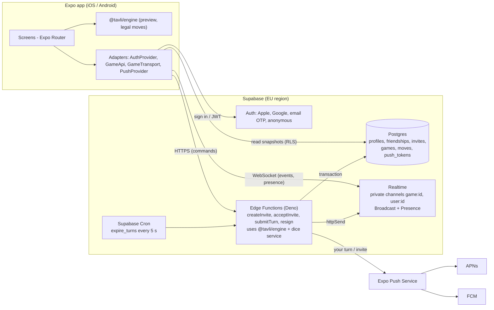

# Backend options for online play

> **Decision update (2026-10-26):** the owner chose **Convex** (the runner-up below) to make keeping phones in sync easier, with **Better Auth** for sign-in. See [ADR-0004](../decisions/0004-backend-auth.md). This doc keeps the original research; its Supabase recommendation is no longer the plan.

Status: research and recommendation. Not a final decision.
Date: 2026-10-26. Prices were checked on the official pricing pages on this date (see [Sources](#8-sources)).
Prices change often. Check them again before you pay for anything.

**Short answer**

- **Primary:** Supabase for everything at first: Auth, Postgres, Realtime and Edge Functions. The shared TypeScript engine checks every move inside an Edge Function. Expo Push sends the notifications. Cost: $0 while building. Then $25/month (Pro) at launch. About $40–60/month at ~10k MAU.
- **Fallback (and the path if you need to scale):** Cloudflare Workers + Durable Objects. One Durable Object runs each live game. Keep Supabase Auth and Postgres, or move fully to Cloudflare (D1 + Better Auth). About $5–10/month at ~10k MAU.
- **Runner-up:** Convex. It fits very well technically, but its API is more lock-in.
- The app only talks to small TypeScript interfaces (`AuthProvider`, `GameApi`, `GameTransport`, `PushProvider`). This means a provider can be swapped later without rewriting screens.

---

## 1. Requirements

### MVP (must have at launch)

| # | Requirement | Notes |
|---|---|---|
| R1 | Sign in with Apple, Google, email (code or magic link) | Apple guideline 4.8 needs a privacy-friendly login (Sign in with Apple) if you offer Google. |
| R2 | Guest (anonymous) account that can be upgraded later | Lets a friend play from an invite link with no sign-up. |
| R3 | Account deletion inside the app | App Store rule 5.1.1(v). Plan it from day one. |
| R4 | Friend list (add by username or friend code) | |
| R5 | Invite a friend in the app, and share an invite link with people who do not have the app yet | Universal links (iOS) and App Links (Android). |
| R6 | Server-authoritative dice and move validation | The same pure TS engine runs on the client (preview, UI) and on the server (the truth). |
| R7 | Live play: both players see moves in real time | Target: under 0.5 s from submit to the opponent's screen. |
| R8 | Async play: you can close the app and get a push notification when it is your turn | **Recommendation: include in MVP.** Every move is saved in the database anyway, so async play is mostly free. Only push notifications are extra work. |
| R9 | Reconnect after a network drop, with no lost or duplicated moves | Use a version number on every game state. |
| R10 | Presence: online/offline for friends, and "opponent is here" inside a game | |
| R11 | Turn timers (short for live games, long for async games) | Run on the server, not only on the client. |
| R12 | Push notifications (invite received, your turn, game over) | |

### Later

| # | Requirement |
|---|---|
| L1 | Matchmaking with strangers |
| L2 | Ratings (Elo or Glicko-2) |
| L3 | Match history and replays (the `moves` table gives this almost for free) |
| L4 | Leaderboards |
| L5 | Chat and emotes (emotes first, because they need no moderation) |
| L6 | iMessage extension |
| L7 | Anti-abuse: CAPTCHA on guest sign-up, App Attest / Play Integrity, bot detection |
| L8 | Web version (Expo Router web), for example "play in the browser" from an invite link |

### Non-functional

- Most affordable: $0 while building, low fixed cost at launch.
- Future-proof: open standards (Postgres, SQL, HTTP, WebSocket). No dead-end vendor features.
- Solo developer: few moving parts, managed hosting, a good dashboard.
- Greek / EU players: host data in an EU region (for example Frankfurt) for GDPR and low latency.

---

## 2. Comparison table

Cost assumptions (rough, to compare options; not a promise):

- ~1k MAU ≈ 3,000 online games a month. ~10k MAU ≈ 30,000 games a month.
- One game ≈ 60 turns ≈ 120 server calls ≈ 300 realtime messages delivered (moves, dice, presence).
- Peak concurrent players ≈ 3–5% of MAU (about 50 at 1k, about 300–500 at 10k).
- Auth costs are $0 at these sizes for every provider below (all have 50k+ free users).

| Option | Realtime | Server TS logic | Auth | Free tier (key limits) | ~1k MAU / month | ~10k MAU / month | Lock-in risk | Expo support |
|---|---|---|---|---|---|---|---|---|
| **Supabase** | Broadcast + Presence over WebSocket. Private channels with RLS. Can broadcast from DB triggers. | Edge Functions (Deno, TS). 2 s CPU, 256 MB per request. | Built in. Apple, Google, email OTP/magic link, **anonymous** with linking. | 50k MAU, 500 MB DB, 200 concurrent realtime, 2M messages, 500k function calls. **Pauses after 1 week with no activity.** 2 projects. | $0 (Free fits). $25 if you go Pro at launch (recommended). | ~$40–60 (Pro $25 + extra messages, function calls and connections) | **Low–medium.** Open source and self-hostable. Data is plain Postgres. Realtime API is Supabase-specific. | Very good. supabase-js works in React Native. Official Expo guides. |
| **Firebase** | Firestore / RTDB listeners (data sync, not messages) | Cloud Functions (Node, TS). **Need the Blaze plan** (card on file). Cold starts. | Firebase Auth: Apple, Google, email link, anonymous. 50k MAU free, then $0.0055/MAU. | Firestore: 50k reads, 20k writes per day. RTDB: 100 connections. Functions: 2M calls/month on Blaze. | ~$0 | ~$10–20 | **High.** Proprietary data model and security rules. Google has shut down game features before. | Good. The JS SDK works. `@react-native-firebase` needs a dev build. |
| **Convex** | Reactive queries. Every client sees changes automatically. Presence component. | **Excellent.** TS mutations are transactional. Built-in scheduler for timers. | Convex Auth (has an anonymous provider), Better Auth component, or Clerk. | 1M function calls, 0.5 GB DB, 1 GB egress, 1,000 concurrent sessions. | ~$0–5 | ~$25–35 (Pro $25/developer includes 25M calls) | **Medium.** The backend is source-available (FSL, becomes Apache-2.0 later) and self-hostable, but the code only fits Convex. | Good. Official React / React Native client. |
| **Cloudflare Workers + Durable Objects** (+ partyserver) | WebSocket per game room. Hibernation means idle rooms cost almost nothing. | **Excellent.** One DO per game = one single-threaded authority. Alarms for timers. SQLite storage. | None. Bring Better Auth, Supabase Auth or Clerk. | Free plan: 100k requests/day, 13k GB-s/day, 5 GB SQLite. | $0 (Free) or $5 (Paid) | ~$5–10 | **Medium.** The DO API is Cloudflare-only. A thin wrapper around the pure engine makes porting easy. | Good. A plain WebSocket or `partysocket` works in React Native. |
| **Colyseus** (+ Colyseus Cloud) | WebSocket rooms with state sync | **Excellent.** Node.js + TS rooms. | None. Bring your own. | No cloud free tier. Self-host is free (MIT). | ~$15 (Cloud) or ~$5–10 (VPS) + a DB | ~$15–40 + a DB | **Low.** MIT license. Runs on any Node host. | OK. The JS SDK works in React Native. Test it early. |
| **Nakama** (Heroic Labs) | WebSocket. Authoritative matches. Built-in friends, leaderboards, matchmaker, notifications. | TS runtime on goja: **must compile to ES5**. No Node APIs. No in-memory global state. | Built in (device, email, Apple, Google). | Self-host is free (Apache-2.0). Heroic Cloud prices are not published. | ~$10–25 (VPS + Postgres) | ~$20–50 self-hosted. Cloud: ask sales. | **Low** (open source), but **high ops work**. | OK. `nakama-js` works in React Native. |
| **Appwrite Cloud** | Realtime subscriptions on DB events | Functions (Node, Bun, Deno). Cold starts. | Built in, including anonymous. | 75k MAU, 750k function calls, 5 GB bandwidth. Project freezes at a limit. | $0 | ~$25–35 (Pro $25) | **Low–medium.** Open source and self-hostable. | Good. Official React Native SDK. |
| **PocketBase** (self-host) | Realtime subscriptions (SSE) | JS hooks on goja (limited) or Go | Built in (email, OAuth2) | Free. You pay for a VPS. | ~$5 | ~$5–10 | **Low**, but **pre-1.0** (breaking changes) and one server only | OK. SSE needs a polyfill in React Native. |

### Auth-only options

| Option | Apple (native) | Google (native) | Email | Guest / anonymous + upgrade | Free | Then |
|---|---|---|---|---|---|---|
| **Supabase Auth** | Yes (`signInWithIdToken`). No 6-month key rotation for the native flow. | Yes (ID token) | OTP code or magic link. **Needs your own SMTP** (the built-in one only sends 2 emails/hour, to team members only). | Yes. `signInAnonymously`, then `linkIdentity` or `updateUser({ email })`. | 50k MAU (Free), 100k (Pro) | $0.00325/MAU |
| **Firebase Auth** | Yes | Yes | Email link | Yes. `linkWithCredential`. Auto-cleanup after 30 days (Identity Platform). | 50k MAU | $0.0055/MAU (50k–100k) |
| **Clerk** | Yes (native in Expo since Nov 2025) | Yes | Yes | **Not documented.** I found no guest/anonymous feature. | 50k MRU (Hobby; only 3 social logins; 7-day sessions) | Pro $25/month, then $0.02/MRU |
| **Better Auth** | Yes (ID token) | Yes | Magic link plugin | Yes. Anonymous plugin with an `onLinkAccount` hook to move data. | Free (open source). You host it and its DB. | Your hosting cost |
| **Convex Auth** | Through OAuth | Through OAuth | Yes | Anonymous provider, but you write the account linking yourself | Part of Convex | Part of Convex |

**Auth pick:** Supabase Auth. It covers all MVP needs, including guests. It is free up to 50k MAU, and it comes with the DB. Wrap it behind `AuthProvider`, so Better Auth stays a free way out.

---

## 3. Pros and cons per option

### Supabase (primary)

Pros
- One vendor for Auth, DB, realtime, functions, cron and storage. One dashboard. Good for a solo developer.
- Postgres is the most portable choice. Friends, invites, history, ratings and leaderboards are plain SQL.
- Realtime **Broadcast** (low-latency messages) and **Presence** (who is online) are what a game needs. **Private channels** use RLS, so only the two players can join `game:<id>`.
- You can broadcast from the database (`realtime.send`, `realtime.broadcast_changes`), or from a function with `httpSend()` (no socket needed).
- Edge Functions are TypeScript (Deno). A pure TS engine runs there with no changes.
- Supabase Cron runs jobs from every second up to once a year, and can call Edge Functions. Good for turn timers.
- Anonymous sign-in with upgrade is built in.
- Open source. You can self-host later if the bill grows.
- Pro has a spend cap, so there are no surprise bills.

Cons
- Free projects **pause after 1 week with no activity** and have no backups. Use Pro ($25) for the live app.
- Every move is an HTTP call to a stateless function. Each call loads the game from Postgres, validates it, then saves it. That costs more latency (~100–400 ms) than an in-memory game room. This is fine for backgammon, but not instant.
- Realtime billing counts every message **delivered to each client**. Do not subscribe from servers. Use `httpSend()`.
- Edge Functions have a 2 s CPU limit per request. The engine must be fast (it will be; backgammon move generation is cheap).
- Two calls for the same game at the same time need care. Use a `version` column or `SELECT … FOR UPDATE`.

### Firebase

Pros
- Generous free quotas. FCM is free. Very mature mobile SDKs.
- Firestore listeners make async games easy.

Cons
- Cloud Functions need the Blaze plan (card on file). They have cold starts.
- Firestore is a document store with proprietary security rules. Ratings and leaderboards need extra work (no SQL joins or ranks).
- Highest lock-in. Google has shut down Play Games turn-based multiplayer (2020) and Dynamic Links (2025).
- `@react-native-firebase` needs native config. The JS SDK is lighter, but has fewer features.

### Convex (runner-up)

Pros
- Best developer experience for this kind of game. Mutations are TS transactions, so there are no race conditions. Queries are reactive, so the live feel comes free. The scheduler (`runAfter`) makes turn timers easy.
- The engine runs inside mutations as is.
- Good free tier (1M calls/month).

Cons
- The API and data model are Convex-only. Leaving means rewriting the backend layer, not just changing a config.
- Every subscription refresh counts as a function call. Costs grow with how many screens watch live data.
- Auth is less turnkey. Convex Auth is younger. Better Auth and Clerk are separate pieces.
- Pro is priced per developer ($25 each). That is fine solo, but grows with a team.

### Cloudflare Workers + Durable Objects (fallback / scale path)

Pros
- The perfect shape for a game room. One Durable Object per game is single-threaded, holds the state in memory, writes to its own SQLite, and pushes over WebSocket. Turn timers use **alarms**.
- **WebSocket Hibernation**: idle connections stay open and you pay no duration charges. Pings are answered without waking the object. This is ideal for slow, turn-based games.
- Very cheap. The Free plan covers development. Paid is $5/month and likely covers 10k MAU.
- `partyserver` / `partysocket` (open source, ISC) add rooms, broadcast and client reconnect on top of DOs.
- Runs at the edge, near players.

Cons
- No auth, no admin UI, no push and no friends system. You build or add them.
- The DO API is Cloudflare-only. Keep the engine pure and the DO thin, so porting to Node/Colyseus is about a week of work.
- A code deploy disconnects all WebSockets. Clients must reconnect smoothly (they must anyway).
- More moving parts if you mix it with Supabase (two vendors, two consoles).

### Colyseus

Pros
- Made for multiplayer games. Rooms, state sync, reconnect tokens, matchmaking. Node + TS.
- MIT license. Self-host anywhere.

Cons
- Colyseus Cloud has no free tier (from $15/month). Self-hosting means running a server.
- You still need auth, a database, push and friends from elsewhere.
- Built for real-time action games. A turn-based game uses little of it, and you keep a server running 24/7 anyway.

### Nakama (Heroic Labs)

Pros
- The most complete game backend: friends, groups, chat, leaderboards, tournaments, matchmaker, notifications and authoritative matches. Apache-2.0.

Cons
- The TS runtime is goja, ES5 only. No Node APIs, no global state, npm modules must be bundled. Your engine must compile to ES5 and avoid modern APIs. This is a real constraint.
- You run Go + Postgres/CockroachDB yourself, or pay Heroic Cloud (prices not published; contact sales).
- Heavy for one developer.

### Appwrite (brief)

- Pros: open source (self-hostable), generous free tier (75k MAU), auth with anonymous users, realtime, official React Native SDK.
- Cons: functions have cold starts. Realtime is DB-event based, so there is no presence or broadcast like Supabase has. Free projects freeze at limits. Pro is $25/month. Smaller ecosystem.

### PocketBase (brief)

- Pros: a single Go binary with SQLite. Very cheap on a $5 VPS. Simple admin UI.
- Cons: pre-1.0 (no backward-compatibility promise). One server only. The JS hooks run on goja (limited). Realtime uses SSE (needs a polyfill in React Native). Not future-proof enough for this project.

### What other turn-based board-game apps do

- **Lichess** (chess, open source): a separate WebSocket service (`lila-ws`) talks to the main app over Redis pub/sub. The rules live in a separate library (`scalachess`), and the server validates every move. On reconnect, the client sends the last game **version** it saw and gets the missing events. **Lesson:** pure rules library + server authority + versioned events.
- **boardgame.io** (open source JS framework for board games): the same game code runs on client and server. Moves are pure reducers. The **RNG state stays on the server**, so clients cannot predict dice. Seeds make games replayable. **Lesson:** this is exactly the shape of our `@tavli/engine`.
- **Platform turn-based services** (Apple Game Center `GKTurnBasedMatch`, the old Google Play Games turn-based API): these are easy, but they are tied to one platform, and Google **shut its version down in March 2020**. Games built on it broke. **Lesson:** do not build on a platform-only service. Own the backend behind interfaces.
- The common pattern: an **event log of moves** + a **snapshot of state** + a **version number** + **push for async**. Live play is just "both players subscribed to the same game channel".

---

## 4. Recommended architecture

### 4.1 Primary: Supabase + shared TS engine + Expo Push



The rules in one line each:

- **Clients send commands** over HTTPS to Edge Functions. Clients never write game tables directly; RLS allows only `select`.
- **The server is the only writer** of `games` and `moves`. It validates with the same engine.
- **Events go out** on private Realtime channels. Each event carries the new `version`.
- **The DB is the truth.** On any gap or reconnect, the client re-reads the snapshot.

### 4.2 Fallback: Cloudflare Durable Objects for games

```
 Expo app ──HTTPS──> Worker (auth check: verify Supabase JWT or Better Auth session)
    │                     │
    └──WebSocket──> GameRoom Durable Object (one per game)
                      - holds state in memory + SQLite
                      - validates with @tavli/engine
                      - rolls dice (crypto RNG / committed seed)
                      - alarm() = turn timer
                      - broadcasts to both sockets (hibernation)
                      - on finish: writes result to Postgres/D1, sends push
```

Use it when: Supabase latency or cost becomes a problem, or Supabase changes something important.
What changes: only the server side of `GameApi` and `GameTransport`. Auth, friends and invites can stay on Supabase.
Full-Cloudflare variant: D1 (SQLite) for users and friends + Better Auth on Workers. About $5/month, but more for you to build.

### 4.3 Data model sketch (Postgres)

```sql
-- Profile for each auth user (guest or full)
create table profiles (
  id            uuid primary key references auth.users(id) on delete cascade,
  username      text unique,              -- null for guests until they pick one
  display_name  text not null,
  avatar_url    text,
  friend_code   text unique not null,     -- short code, e.g. 'K7Q2-9F'
  is_guest      boolean not null default true,
  locale        text default 'el',
  last_seen_at  timestamptz,              -- friend list "online" dot
  rating        numeric default 1500,     -- later (Glicko-2: + rd, volatility)
  created_at    timestamptz default now()
);

create table friendships (
  user_low      uuid references profiles(id) on delete cascade,
  user_high     uuid references profiles(id) on delete cascade,
  requested_by  uuid not null,
  status        text not null check (status in ('pending','accepted','blocked')),
  created_at    timestamptz default now(),
  primary key (user_low, user_high),
  check (user_low < user_high)
);

create table invites (
  id          uuid primary key default gen_random_uuid(),
  code        text unique not null,        -- used in https://tavli.app/i/<code>
  from_user   uuid not null references profiles(id),
  to_user     uuid references profiles(id),-- null = open link invite
  settings    jsonb not null,              -- variants (portes/plakoto/fevga), match length, mode live|async, timer
  status      text not null check (status in ('pending','accepted','declined','cancelled','expired')),
  game_id     uuid,
  expires_at  timestamptz not null,
  created_at  timestamptz default now()
);

create table games (
  id             uuid primary key default gen_random_uuid(),
  player_white   uuid not null references profiles(id),
  player_black   uuid not null references profiles(id),
  settings       jsonb not null,
  status         text not null check (status in ('active','finished','abandoned')),
  state          jsonb not null,           -- engine snapshot (board, dice, whose turn, match score)
  version        int not null default 0,   -- +1 on every accepted command
  turn_user      uuid,
  turn_deadline  timestamptz,
  dice_commit    text not null,            -- sha256(seed), public from the start
  dice_seed      text,                     -- revealed only when the game finishes
  winner         uuid,
  result         jsonb,                    -- points, type (single / double ...), reason (normal, resign, timeout)
  created_at     timestamptz default now(),
  finished_at    timestamptz
);
create index on games (turn_deadline) where status = 'active';

create table game_secrets (               -- no RLS policy at all = clients can never read it
  game_id  uuid primary key references games(id) on delete cascade,
  seed     bytea not null
);

create table moves (                       -- event log: replay, history, anti-cheat audit
  game_id     uuid references games(id) on delete cascade,
  seq         int not null,                -- equals games.version after this event
  user_id     uuid,
  kind        text not null,               -- 'roll' | 'turn' | 'resign' | 'timeout' | 'game_end'
  dice        smallint[],
  payload     jsonb,                       -- checker moves, e.g. [[24,18],[13,11]]
  created_at  timestamptz default now(),
  primary key (game_id, seq)
);

create table push_tokens (
  token       text primary key,            -- ExponentPushToken[...]
  user_id     uuid not null references profiles(id) on delete cascade,
  platform    text not null,               -- ios | android
  updated_at  timestamptz default now()
);
```

Later tables: `rating_history`, `leaderboard_season`, `chat_messages`, `reports`, `matchmaking_queue`.

### 4.4 Flow: invite → accept → play → finish

```mermaid
sequenceDiagram
  participant A as Player A (app)
  participant F as Edge Functions
  participant D as Postgres
  participant R as Realtime
  participant P as Expo Push
  participant B as Player B (app)

  A->>F: createInvite({ toUser: B | null, settings })
  F->>D: insert invite (code, expires_at)
  alt friend invite
    F->>R: broadcast user:B "invite.new"
    F->>P: push to B "A invited you to Tavli"
  else link invite
    F-->>A: https://tavli.app/i/CODE (A opens share sheet)
  end
  B->>B: tap push / link → Expo Router /invite/CODE<br/>(not signed in → anonymous sign-in)
  B->>F: acceptInvite(CODE, clientSeedB)
  F->>D: tx: check invite, create game, store seed, dice_commit,<br/>opening roll, turn_deadline, invite=accepted
  F->>R: broadcast user:A "invite.accepted" {gameId}
  F->>P: push to A (only if A is not online)
  A->>R: join private channel game:ID (presence)
  B->>R: join private channel game:ID (presence)
  A->>D: select game snapshot (version N)
  loop each turn
    A->>F: submitTurn(gameId, expectedVersion=N, moves)
    F->>D: tx: lock row, check turn + version,<br/>engine.applyTurn (validate), insert moves,<br/>roll dice for next player, version=N+1, new deadline
    F->>R: broadcast game:ID "state" {version N+1, lastTurn, dice, deadline}
    F->>P: push "Your turn" (only if B is not in the channel)
    R-->>B: event; B applies it if version = local+1, else re-reads the snapshot
  end
  F->>D: game finished: winner, result, reveal dice_seed
  F->>R: broadcast "game.finished"
  F->>P: push "Game over" to anyone offline
```

Details that matter:

- **Idempotency.** Each command carries `expectedVersion` (and a client `commandId`). A repeated submit after a network drop gets "already applied" and the current snapshot. It is never applied twice.
- **Reconnect.** The Supabase client reconnects by itself. On `SUBSCRIBED` again, the app re-reads `games` (one row) and continues. Events are hints. The DB row is the truth.
- **Presence.** In a game: Realtime Presence on `game:<id>` (shows "opponent here" and decides "push or not"). Friend list: update `profiles.last_seen_at` every ~60 s while the app is in the foreground, and show "online" if it is under 2 min old. Do **not** put all users in one global presence channel, because it does not scale.
- **Turn timers.** Store `turn_deadline` in the row. Supabase Cron calls `expire_turns()` every 5 s. It finds active games past the deadline and applies the rule (live: forfeit after the time bank runs out; async: forfeit after, say, 48–72 h, with a reminder push at 24 h). Every `submitTurn` also checks the deadline (lazy check), so the timer is correct even if cron is late. The client only shows a countdown.
- **Live vs async.** It is the same code. "Live" just means both players are subscribed. The settings pick the timer length.
- **Fewer calls.** Greek tavli has no doubling cube in casual play, so the server can roll the next player's dice as part of `submitTurn`. That is one call per turn, not two. (If you add a cube later, add a separate `roll` command.)

### 4.5 Dice: rolled on the server

**Simple version (MVP):** in the Edge Function, use `crypto.getRandomValues()` and rejection sampling for a fair 1–6. Store the dice in the `moves` table. Clients never get dice before the server commits them.

**Verifiable version (commit–reveal, recommended because it costs little):**

1. At game creation, the server makes `seed` = 32 random bytes. It stores it in `game_secrets` and publishes `dice_commit = sha256(seed)`.
2. Optional: each player sends a random `clientSeed` when accepting or starting. The server cannot change `seed` after the commit. Clients cannot predict dice because `seed` is secret.
3. Roll number *n* = `HMAC-SHA256(seed, gameId | n | clientSeedA | clientSeedB)`. Take bytes and use rejection sampling (drop values ≥ 252, then `v % 6 + 1`).
4. At game end, publish `seed`. Any client can check every roll in the history. This gives a "provably fair dice" badge, which is a nice trust feature for a dice game.

```ts
// packages/engine/src/dice.ts — pure, same code on client (verify) and server (roll)
export interface DiceSource { roll(n: number): Promise<[Die, Die]> }
export type Die = 1 | 2 | 3 | 4 | 5 | 6;

export async function diceFromSeed(seed: Uint8Array, ctx: string, n: number): Promise<[Die, Die]> {
  const key = await crypto.subtle.importKey('raw', seed, { name: 'HMAC', hash: 'SHA-256' }, false, ['sign']);
  const mac = new Uint8Array(await crypto.subtle.sign('HMAC', key, new TextEncoder().encode(`${ctx}|${n}`)));
  const out: Die[] = [];
  for (const b of mac) { if (b < 252) out.push(((b % 6) + 1) as Die); if (out.length === 2) break; }
  return [out[0], out[1]]; // 32 bytes: running out of values is practically impossible; add a counter loop to be strict
}
```

The engine never calls `Math.random()`. It gets a `DiceSource`. That keeps it pure and testable, the same as boardgame.io.

### 4.6 Plug-and-play adapter interfaces

The app imports only these interfaces (in `packages/contracts`). Each provider is one folder (`adapters/supabase`, `adapters/cloudflare`, ...). One file in the app chooses which one to use.

```ts
// ---------- shared types ----------
export type UserId = string;
export type GameId = string;
export interface Session { userId: UserId; isGuest: boolean; accessToken: string; expiresAt: number }
export interface Unsubscribe { (): void }

// ---------- Auth ----------
export interface AuthProvider {
  getSession(): Promise<Session | null>;
  onSessionChange(cb: (s: Session | null) => void): Unsubscribe;
  signInAsGuest(): Promise<Session>;
  signInWithApple(): Promise<Session>;          // native on iOS, web flow on Android
  signInWithGoogle(): Promise<Session>;
  sendEmailCode(email: string): Promise<void>;  // OTP code is easier on mobile than a magic link
  verifyEmailCode(email: string, code: string): Promise<Session>;
  upgradeGuest(method: 'apple' | 'google' | { email: string }): Promise<Session>; // keeps the same userId
  signOut(): Promise<void>;
  deleteAccount(): Promise<void>;               // App Store requirement
}

// ---------- Commands (request/response) ----------
export interface GameApi {
  createInvite(input: { toUser?: UserId; settings: GameSettings }): Promise<{ code: string; url: string }>;
  acceptInvite(code: string, clientSeed?: string): Promise<{ gameId: GameId }>;
  declineInvite(code: string): Promise<void>;
  getGame(gameId: GameId): Promise<GameSnapshot>;         // always safe to call: the truth
  submitTurn(cmd: { gameId: GameId; expectedVersion: number; commandId: string; moves: CheckerMove[] })
    : Promise<CommandResult>;
  resign(gameId: GameId, expectedVersion: number): Promise<CommandResult>;
  listMyGames(filter?: { status?: 'active' | 'finished' }): Promise<GameSummary[]>;
}
export type CommandResult =
  | { ok: true; snapshot: GameSnapshot }
  | { ok: false; reason: 'not_your_turn' | 'stale_version' | 'illegal_move' | 'game_over' | 'timeout'; snapshot: GameSnapshot };

// ---------- Realtime (events + presence) ----------
export type GameEvent =
  | { type: 'state'; version: number; snapshot: GameSnapshot }
  | { type: 'finished'; version: number; result: GameResult; diceSeed: string }
  | { type: 'emote'; from: UserId; emote: string };       // later
export interface GameTransport {
  joinGame(gameId: GameId, handlers: {
    onEvent(e: GameEvent): void;
    onPresence(online: UserId[]): void;
    onConnection(state: 'connecting' | 'live' | 'offline'): void; // the UI shows "reconnecting…"
  }): Unsubscribe;
  watchUser(userId: UserId, onEvent: (e: { type: 'invite.new' | 'invite.accepted'; payload: unknown }) => void): Unsubscribe;
  sendEmote?(gameId: GameId, emote: string): Promise<void>;
}

// ---------- Persistence (server side; also lets you swap Postgres <-> D1 <-> DO storage) ----------
export interface GameRepository {
  loadForUpdate(gameId: GameId): Promise<{ game: GameRow; secret: Uint8Array }>; // locks the row
  saveTurn(gameId: GameId, expectedVersion: number, next: GameRow, events: MoveRow[]): Promise<void>; // throws on version conflict
  findExpired(now: Date, limit: number): Promise<GameId[]>;
}
export interface SocialRepository {
  listFriends(userId: UserId): Promise<FriendSummary[]>;
  requestFriend(from: UserId, friendCode: string): Promise<void>;
  respondFriend(userId: UserId, other: UserId, accept: boolean): Promise<void>;
}

// ---------- Push ----------
export interface PushProvider {            // client side
  register(): Promise<{ token: string; platform: 'ios' | 'android' } | null>; // asks permission, saves the token
  onNotificationTap(cb: (data: { kind: string; gameId?: GameId; inviteCode?: string }) => void): Unsubscribe;
}
export interface PushSender {              // server side
  send(msgs: Array<{ userId: UserId; title: string; body: string; data: Record<string, string> }>): Promise<void>;
}
```

Server code is also split: `domain/` (engine + rules, pure), `ports/` (the interfaces above), `adapters/` (Supabase, Cloudflare, Expo Push). An Edge Function or a Durable Object is just a thin shell that calls `domain/`.

### 4.7 Suggested repo layout

```
apps/mobile                 Expo app (Expo Router)
packages/engine             pure TS rules for portes / plakoto / fevga, no React, no Node APIs
packages/contracts          the interfaces + zod schemas for commands/events
packages/adapters-supabase  client adapters
supabase/functions          Edge Functions (import engine + contracts)
supabase/migrations         SQL schema + RLS
web/                        tiny static site for tavli.app (invite pages, AASA, assetlinks)
```

---

## 5. Deep links and invites

**Link format:** `https://tavli.app/i/<code>` (use your own domain; buy it early). Also register a custom scheme (`tavli://`) for development and OAuth redirects.

**Setup**

- Expo Router turns a URL path into a screen automatically: `app/i/[code].tsx`.
- **iOS universal links:** add `ios.associatedDomains: ["applinks:tavli.app"]` in the app config. Host `/.well-known/apple-app-site-association` over HTTPS. iOS reads it at install or update, so path changes need a new app release.
- **Android App Links:** add `android.intentFilters` with `autoVerify: true` for `https://tavli.app/i/*`. Host `/.well-known/assetlinks.json` with your SHA-256 fingerprint (`eas credentials -p android`, plus the Play App Signing key).
- **Hosting:** the small static site can be on Cloudflare Pages (free) or EAS Hosting. Supabase is not a good fit for root-domain static files.

**What a person without the app sees**

1. The link opens in the browser: a small page, "Nikos invited you to play Plakoto". It shows App Store and Google Play buttons, plus the Apple Smart App Banner (`<meta name="apple-itunes-app" ...>`).
2. It also shows the **invite code** in large text ("or enter code K7Q2 in the app").
3. **Android:** put the code in the Play Store link (`&referrer=invite%3DK7Q2`). Read it on first launch with the Play Install Referrer API. The invite then opens by itself after install (real deferred deep link, free).
4. **iOS:** there is no free, official deferred deep link. Options: (a) the user taps the link again after install (it now opens the app); (b) the user types or pastes the code on the first screen; (c) a paid service (Branch etc.). Firebase Dynamic Links shut down in August 2025, so do not use it. **Recommendation:** (a) + (b) for MVP. Both are free and simple.
5. **Later:** "Play in browser now" with an Expo Router web build and a guest account. This gives the best conversion and no install friction.

**iMessage (later):** Expo has no built-in iMessage extension. It needs a native Swift target (for example through a config plugin such as `@bacons/apple-targets`). Recommendation: the iMessage bubble carries only `gameId` + a small board picture/summary in the `MSMessage` URL. All moves still go through the **same backend**. If state lived only in the messages, dice could be faked and anti-cheat would be lost.

---

## 6. Push notifications

**Recommendation: Expo Push Service, behind `PushSender`.**

- It is free. Limit: 600 notifications per second per project. One API for iOS and Android. `expo-server-sdk` (Node) or a plain `fetch` from Deno handles batching.
- You still upload credentials once to EAS: an **FCM v1** service-account key (Android) and an **APNs key** (iOS). Push needs a development build, not Expo Go.
- Server rules:
  - Send "Your turn" only when the opponent is **not** in the game channel (presence check). This avoids spam during live play.
  - Collapse per game (`collapseId` / thread id), so a long async game does not pile up notifications.
  - Read push **receipts** later. Delete tokens that return `DeviceNotRegistered`.
  - Put `{ kind, gameId | inviteCode }` in `data`. A tap opens the right screen through Expo Router.
  - Let users pick in settings: invites / your turn / reminders.
- **Exit path:** `getDevicePushTokenAsync()` gives native FCM/APNs tokens if you ever want to send directly (for example, for iOS Live Activities or rich features). Only the `PushSender` adapter changes.
- Firebase is not needed for anything except the FCM credential that Android requires.

---

## 7. Risks and open questions

### Risks

| Risk | Impact | What to do |
|---|---|---|
| Supabase free project pauses after 7 days with no activity | App down in beta | Use Pro ($25) for the production project. Keep Free for dev. |
| Realtime messages can be missed (at-most-once delivery) | Board out of sync | Version numbers, re-read the snapshot on gap or reconnect. Never trust events alone. |
| Edge Function latency / cold starts | Moves feel slow | Keep functions small. Pick the EU region near players. Measure early. If it is bad, move the game rooms to Durable Objects (fallback). |
| Race: two submits at once | Corrupt game | Row lock + `expectedVersion` check inside one transaction. |
| Cost surprise (realtime messages count per recipient) | Bill grows | Spend cap on. Use `httpSend()` from servers. No global presence channel. |
| Guest account spam | DB filled with junk | CAPTCHA/Turnstile on anonymous sign-in. Delete old guests with no games (cron). |
| App Store review | Rejection | Sign in with Apple, account deletion, guest play without forced sign-up, a privacy policy. |
| Email deliverability | Users cannot log in | Custom SMTP (for example Resend or Postmark) + SPF/DKIM/DMARC. The built-in Supabase email is for testing only. |
| Engine bugs differ between client and server | "Illegal move" errors | One package, many tests (property tests, fixtures of real games). The server is always right. |
| Vendor change or shutdown | Rewrite | The interfaces in section 4.6. Data in plain Postgres. Regular `pg_dump` backups. |
| iOS deferred deep links | Some invitees get lost | Invite code fallback. Measure. Buy a link service only if numbers say so. |
| GDPR (Greek/EU users) | Legal | EU region, data export/delete, short data retention for guests. |

### Questions for the owner

1. **Live + async both in MVP?** My advice: yes, one code path. The extra work is push notifications. Do you agree?
2. **Timers:** what are the live time controls (for example 60 s per turn + time bank)? How long can an async turn be (24/48/72 h)? Timeout = lose the game or lose the point?
3. **Variants and match format at launch:** Portes, Plakoto and Fevga as a "tavli match" to 3/5/7 points, or single games? (The README also lists Asodio.)
4. **Guests:** can a guest play online with friends from a link (my advice: yes), or must they sign up first?
5. **Friend discovery:** username search, friend code, or contacts import (privacy cost)?
6. **Domain:** which domain for invite links (needed before the first build that has universal links)?
7. **Budget:** is ~$25/month from launch OK (Supabase Pro + Apple $99/year + Google $25 once)?
8. **Provably fair dice** (commit–reveal) in MVP, or later? It is cheap to add at the start and hard to add after.
9. **iMessage extension:** how important? It needs native Swift work outside Expo.
10. **Web/browser play** for invitees: wanted early? It changes the deep-link plan.
11. **Chat:** emotes only (no moderation needed), or free text (needs reporting/blocking)?

---

## 8. Sources

Pricing and limits (checked 2026-10-26):

- Supabase pricing — https://supabase.com/pricing
- Supabase Realtime limits — https://supabase.com/docs/guides/realtime/limits
- Supabase Realtime Broadcast (DB broadcast, private channels, `httpSend`, billing notes) — https://supabase.com/docs/guides/realtime/broadcast
- Supabase Edge Function limits — https://supabase.com/docs/guides/functions/limits
- Supabase Cron — https://supabase.com/docs/guides/cron
- Supabase anonymous sign-ins — https://supabase.com/docs/guides/auth/auth-anonymous
- Supabase Sign in with Apple (native Expo flow) — https://supabase.com/docs/guides/auth/social-login/auth-apple
- Supabase custom SMTP — https://supabase.com/docs/guides/auth/auth-smtp
- Firebase pricing — https://firebase.google.com/pricing
- Firestore pricing — https://cloud.google.com/firestore/pricing
- Identity Platform pricing — https://cloud.google.com/identity-platform/pricing
- Firebase anonymous auth — https://firebase.google.com/docs/auth/web/anonymous-auth
- Convex pricing — https://www.convex.dev/pricing
- Convex backend license (FSL-1.1-Apache-2.0) and self-hosting — https://github.com/get-convex/convex-backend
- Convex + Better Auth — https://labs.convex.dev/better-auth
- Convex Auth anonymous provider — https://labs.convex.dev/auth/config/anonymous
- Cloudflare Durable Objects pricing — https://developers.cloudflare.com/durable-objects/platform/pricing/
- Cloudflare Workers pricing (incl. KV, D1) — https://developers.cloudflare.com/workers/platform/pricing/
- Durable Objects WebSocket hibernation — https://developers.cloudflare.com/durable-objects/best-practices/websockets/
- PartyServer / PartySocket — https://github.com/cloudflare/partykit
- Cloudflare acquires PartyKit — https://blog.cloudflare.com/cloudflare-acquires-partykit
- Colyseus pricing — https://www.colyseus.io/pricing and https://colyseus.io/cloud-managed-hosting/
- Colyseus Cloud billing / compute plans — https://docs.colyseus.io/cloud/pricing-billing , https://docs.colyseus.io/cloud/compute-plans
- Heroic Cloud pricing (Nakama prices not shown) — https://heroiclabs.com/pricing/
- Nakama (Apache-2.0, features) — https://github.com/heroiclabs/nakama
- Nakama TypeScript runtime (ES5 / goja limits) — https://heroiclabs.com/docs/nakama/server-framework/typescript-runtime/
- Appwrite pricing — https://appwrite.io/pricing ; Pro price change to $25 — https://appwrite.io/changelog/entry/2025-08-08
- PocketBase docs (pre-1.0 warning) — https://pocketbase.io/docs/
- Clerk pricing — https://clerk.com/pricing
- Clerk native Sign in with Apple for Expo — https://clerk.com/changelog/2025-11-13-native-sign-in-with-apple-expo
- Better Auth Expo — https://www.better-auth.com/docs/integrations/expo
- Better Auth anonymous plugin — https://www.better-auth.com/docs/plugins/anonymous

Mobile platform:

- Apple App Review Guidelines (4.8 Login Services, 5.1.1 account deletion) — https://developer.apple.com/app-store/review/guidelines/
- Expo iOS universal links — https://docs.expo.dev/linking/ios-universal-links/
- Expo Android App Links — https://docs.expo.dev/linking/android-app-links/
- Expo push notifications overview — https://docs.expo.dev/push-notifications/overview/
- Expo push setup — https://docs.expo.dev/push-notifications/push-notifications-setup/
- Expo push FAQ (free, 600/s, direct FCM/APNs) — https://docs.expo.dev/push-notifications/faq/
- Firebase Dynamic Links shutdown — https://firebase.google.com/support/dynamic-links-faq (and https://branch.io/resources/blog/firebase-dynamic-links-shutting-down)

Architecture references:

- Lichess architecture (lila-ws, Redis, versioned reconnect) — https://github.com/lichess-org/lila (summary via https://www.mintlify.com/lichess-org/lila/architecture/websockets)
- boardgame.io randomness (server-side PRNG, seeds) — https://github.com/boardgameio/boardgame.io/blob/main/docs/documentation/random.md
- Google Play Games multiplayer API shutdown (2020) — https://support.google.com/googleplay/android-developer/answer/9469745 and https://9to5google.com/2019/09/16/google-play-games-services-shutting-down-multiplayer-api/

Not verified (treat with care): Heroic Cloud Nakama prices (not published); the higher Colyseus Cloud tiers (only "from $15/mo" is shown); whether Clerk has any guest mode; whether Supabase anonymous users count toward MAU (at these sizes it does not matter). All cost numbers at 1k/10k MAU are my estimates from the stated assumptions, not vendor quotes.
