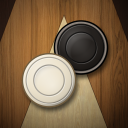
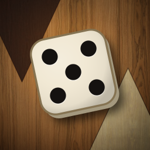
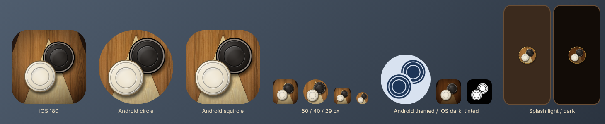
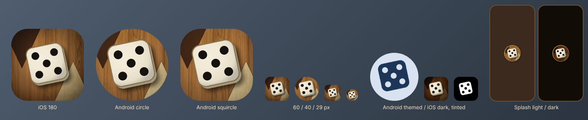
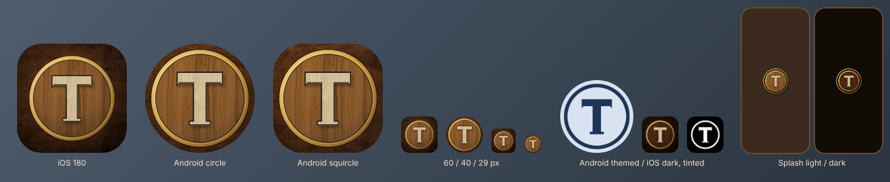

# App icon and splash screen

> Issue #42. Last review: 2026-10-26. Status: **Concept A is wired** as the default. The owner can pick another concept in #42.

All three concepts use the Walnut Kafeneio theme: its palette (`packages/themes/walnut-kafeneio/theme.json`) and its CC0 wood textures. Checkers and the die follow the theme's checker and dice styles, a little bolder.

## Concepts

<table>
<tr>
<td align="center"><b>A. Πούλια (checkers)</b> — pick<br></td>
<td align="center"><b>B. Ζάρι (die)</b><br></td>
<td align="center"><b>C. Τ inlay</b><br></td>
</tr>
<tr>
<td>An ivory and a black checker on a bone point. Says "backgammon" at once and shows the real game pieces of the theme.</td>
<td>One ivory die (a five) with its thickness. The strongest shape at 29 px, but many dice and casino apps look like this.</td>
<td>A bone Τ for Tavlaki / Τάβλι in a brass ring. Most brand-like and calm, but it does not say "board game".</td>
</tr>
</table>

Each concept also has a review sheet: the icon at 180 px, in the Android circle and squircle masks, at 60 / 40 / 29 px, as an Android themed icon, as the iOS dark and tinted icons, and the light and dark splash on a phone at true scale.





## The pick: A (checkers)

- It is the only concept that is clearly **tavli**, not just "a game" (B) or "a letter" (C).
- It reads at 60 × 60 px and at 29 px: two big round shapes, light against dark, on warm wood. Ivory vs black is the theme's best contrast pair (13.4:1).
- The themed icon (Android 13+) and the iOS tinted icon stay clear: two solid discs with the groove and dish cut in, and a gap where they overlap.
- It matches the board the player sees next, so the icon, splash and first screen feel like one thing.

## Files

All files are 1024 × 1024 PNG in `apps/mobile/assets/icon/`. Opaque files have no alpha channel.

| File | Used for | Notes |
|------|----------|-------|
| `icon.png` | `expo.icon`, `ios.icon.light` | Full bleed, opaque. The OS rounds the corners. |
| `icon-ios-dark.png` | `ios.icon.dark` | Same art, wood dimmed (multiply with warm brown) |
| `icon-ios-tinted.png` | `ios.icon.tinted` | White silhouette on black. iOS adds the tint. |
| `android-foreground.png` | `android.adaptiveIcon.foregroundImage` | Checkers only, transparent. They fit in the 66 dp safe circle of the 108 dp canvas. |
| `android-background.png` | `android.adaptiveIcon.backgroundImage` | Walnut field and points, opaque, at the same scale as the foreground |
| `android-monochrome.png` | `android.adaptiveIcon.monochromeImage` | White silhouette, transparent, same place as the foreground |
| `splash.png` | `expo-splash-screen` `image` | A round walnut medallion with a brass ring, transparent outside. It stays inside the middle 2/3 circle that Android 12+ shows. |
| `splash-dark.png` | `expo-splash-screen` `dark.image` | Same, wood dimmed |

Splash config (`apps/mobile/app.json`): `imageWidth` 240, background `#3B2A1D` (`ui.bg`), dark mode `#120C07` (`ui.bg.outer`). The app UI is dark brown in both system modes, so the light splash is dark brown too. A cream splash would flash before the dark app. The root `backgroundColor` is also `#3B2A1D`, so there is no white flash after the splash.

Test the splash in a preview or production build, not in Expo Go or a development build (Expo docs).

## Rebuild

```sh
pnpm --filter @tavli/mobile build:icons                 # default pick (A, "pouli")
pnpm --filter @tavli/mobile build:icons -- --pick zari  # wire concept B instead
```

- Source: `apps/mobile/assets/icon/tools/art.mjs` (the SVG art) and `build-icons.mjs` (layers, rendering, review sheets).
- Needs Playwright with Chromium on the machine, like `@tavli/themes` `build:assets`. Same Chromium gives the same files.
- To change the default for good, change `DEFAULT_PICK` in `build-icons.mjs` and this doc.
- Licenses: see "Used outside this package" in [`packages/themes/LICENSES.md`](../../packages/themes/LICENSES.md). Textures are CC0 1.0 (Poly Haven). The shapes are our own work. No font is used.

## Later

- An Icon Composer `.icon` file for iOS 26 Liquid Glass layers (`ios.icon` accepts a `.icon` folder since SDK 54). The PNG icon works on iOS 26 as is.
- Store listing art (feature graphic, screenshots) is a separate task.
