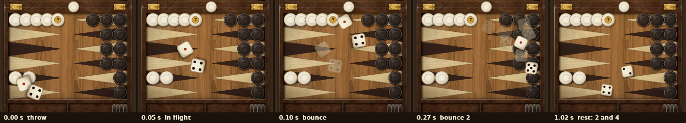

# Dice throw spike: throw the dice onto the board with a swipe

> Issue #183. A design spike: a prototype on the dev board screen, not in real games. Last review: 2026-10-27.

## The idea

The owner asked: "Can we test how throwing the dice on the board like a real game would look? What if I swipe to throw the dice?"

The spike answers three questions: how it looks, what it costs to build for real, and whether we should.

## Try it

1. Run a development build (see [Running the app](../process/running-the-app.md)).
2. Open the dev board screen: `/dev/board` (not linked from the app; release builds go home).
3. Pick **Dice → Throw on the board**.
4. Swipe the board. A tap on the board, or the **Roll** button, throws too.

The board follows Settings: the board theme, the home board side and the layout (Tall or Classic). The dice roll in the field that holds the theme's dice area: the bottom half of the tall board, the right half of the classic board.

## Preview

One throw, drawn headless with the same code the dev screen plays (`pnpm --filter @tavli/mobile screenshots`, file `apps/mobile/tools/screenshots/diceThrow.shot.tsx`). Faint ghosts show where each die just was.

The whole throw as a GIF (30 fps): [throw.gif](dice-throw/throw.gif).

## How it works

All the code is in `apps/mobile/src/features/dice-throw/`, plus a switch on the dev board screen (`src/app/dev/board.tsx`).

1. **The result comes first.** The RNG rolls the dice (`rollDice(rng)`, the same injected RNG the games use). The animation never picks a value.
2. **A plan lands on that result.** `planThrow` (`throwPath.ts`, pure TypeScript, no React) simulates the two dice at 60 samples a second, with 4 physics steps per sample:
   - They start where the finger let go, side by side across the throw, and fly in the swipe direction. The speed is the finger speed from Gesture Handler, clamped to 450–1800 pt/s (`swipeToThrow`). Without a usable velocity it comes from the swipe length.
   - Drag and rolling friction slow them down (`dampSpeed`, an exact formula, so the result does not depend on the frame rate).
   - They bounce off the four walls of the field (`reflect`: half the speed into the wall stays, most of the speed along it stays) and off each other.
   - The walls come from the theme layout: the field rect from `layout.fields`, less half a die (`throwField.ts`).
   - The spin and the faces count **back from the end**. So the die always stops at the theme's resting tilt (`layout.dice.tilt`) and on the rolled value. On the way, a die shows a new face after each 0.9 die sizes of travel, and never the same or the opposite face twice in a row (like a real die rolling over an edge, `faceSequence`).
   - A die is drawn up to 22% bigger at full speed, so it looks "in the air".
   - Same input, same plan: there is no randomness in the planner.
3. **Reanimated plays the plan.** One shared value runs from 0 to the end of the throw (`withTiming`, linear). Each die (`ThrownDie.tsx`) reads its pose with `sampleAt`, a worklet, on the UI thread. It draws with the board's own `DieBody` and `DiePips`.
4. **Knocks.** The plan lists every hit with its time and strength. `hitCues` joins hits closer than 70 ms, and each cue plays `diceLand` (sound and haptic) through `features/feedback`. The throw starts with `diceRoll`.
5. **When the dice stop**, the text under the board says "Rolled 2 and 4." and `useAnnouncement` reads it to screen readers.

Gestures follow the board rules (#174, #186): a pan and a tap race (`useCompetingGestures`), so one touch is never both a swipe and a tap. There is no `...spread` inside the gesture hook configs. A touch that the system takes away (a notification shade, a call) throws nothing.

Reduce Motion: the dice show at rest at once (`restPlan`), with no flight and no knocks.

Tests: `throwPath.test.ts` (the math and the planner: the dice stay inside the field, land on the value at the resting tilt, bounce on a hard throw, stay apart at rest), `throwField.test.ts` (the field on the tall, mirrored and classic layouts) and `DiceThrowBoard.test.tsx` (swipe, tap, Roll button, a cancelled touch, the classic board, the RNG values in order).

## Numbers

| What                                        | Value                                    |
| ------------------------------------------- | ---------------------------------------- |
| One throw, slowest to fastest               | about 0.9 s to 1.1 s                     |
| Wall hits on a hard throw                   | 2 to 5, the first after about 0.1–0.2 s |
| Plan size                                   | about 70 samples, about 11 KB as JSON    |
| Planning time (Node on a laptop)            | about 0.5 ms                             |
| Work per frame on the UI thread             | 2 transforms, 12 face opacities          |

## Cost to build for real

About **6 to 9 days** (size L), in this order:

| Step                                                                                                                                                                                    | Days  |
| --------------------------------------------------------------------------------------------------------------------------------------------------------------------------------------- | ----- |
| Draw the thrown dice on their own canvas over the board, like `DiceRow` does now. Then the board picture does not redraw on every frame of the throw.                                  | 1     |
| Hand over at rest: the dice glide into the dice area (`boardDiceBox`), then `DiceRow` takes over (used dice, the 2 × 2 grid for a double). Today the dice can stop on top of checkers. | 1–1.5 |
| The swipe on the game board when it is your roll. The board pan moves checkers; before the roll there is nothing to move, so a swipe can throw. Keep tap-to-roll and the Roll button. | 1     |
| The other player's throw (bot, pass-and-play, online): a fixed throw from the far wall (`buttonThrow`).                                                                                | 0.5   |
| Online games: the dice come from the server state (see below).                                                                                                                          | 0.5–1 |
| A wooden rattle sound per theme, louder for a harder hit (the feedback port has no volume yet).                                                                                         | 0.5–1 |
| Look: a squash at each face change so the roll reads as 3D, not as a flicker. Tune on phones.                                                                                           | 1     |
| A setting to turn the throw off, and checks on a low-end Android phone.                                                                                                                 | 1     |

The pure parts (`throwPath.ts`, `throwField.ts`) and their tests can stay as they are.

## Risks

**Low-end Android performance.** Not measured in this spike: there was no phone. What we know:

- The plan is made once per throw on the JS thread (about 0.5 ms on a laptop; expect under 10 ms on a slow phone with Hermes, less than one frame).
- During the throw only one shared value changes. The UI thread reads two poses per frame. That is cheap.
- The cost to watch: on the dev screen the dice draw **inside** the board canvas, so Skia redraws the whole board picture (wood images, 30 checkers with shadows) on each frame, and each die has a blurred shadow. In the real build the dice get their own canvas (see the cost table). If a slow phone still drops frames, drop the die shadow blur during the flight.
- Next step: the owner runs the dev screen on a cheap Android phone with the Perf Monitor on (Dev Menu → Perf Monitor) and checks the UI frame rate during a throw. Go only if it stays near 60 fps.

**Accessibility.**

- The swipe is never the only way. The Roll button stays, and a tap throws too. Screen reader users roll with the button (VoiceOver and TalkBack take the swipe for their own gestures).
- With Reduce Motion on, the dice show at rest at once.
- The result is read with `useAnnouncement` once the dice stop. In real games, check `features/game/announcements.ts` first so the roll is not read twice.
- The board view on the dev screen is one accessible element with a label. In real games the move list (`features/accessibility`) stays the way to play.

**Fairness in online games.**

- The server dice stay the truth. The animation lands on the server's result; it never makes one. The swipe speed and direction change only the path, never the faces.
- The server rolls the next dice in the same mutation that saves the last turn (`apps/server/convex/games.ts`). So when your turn starts, the dice are already in the game state. The app plans the throw to land on `state.dice` (the CLAUDE.md rule: play `state.dice` when the state already holds dice). There is no wait for the network during the throw.
- Because the dice are in the state before the throw, a changed app could show them a second early. That gives no real edge: the throw is a show, and the player sees the result a second later anyway.
- The same holds for local games: the injected RNG rolls first, as now.

**Other risks.**

- Doubles: the throw shows two dice; the game shows four. The hand-over step above solves it (`DiceRow` shows the 2 × 2 grid).
- A long throw slows play down. A throw takes about 1 s; a tap during the throw could skip to the rest pose.
- On the classic board the field is small, so the dice hit the walls more often. Tune the speeds per layout if it looks busy.

## Recommendation

**Build it, as a small follow-up after a phone check.** The look is good enough for a 2D tumble, the code is small and pure, and it does not touch the rules or the server. It makes the game feel like a real table, which is the point of the app.

1. Owner: try `/dev/board` on a phone, and on a cheap Android phone if you can. Say yes or no to the look.
2. If yes: open one issue (size L) for the steps in the cost table, local and bot games first, online after.
3. Keep a setting to turn the throw off. Keep the Roll button and tap-to-roll as they are.
