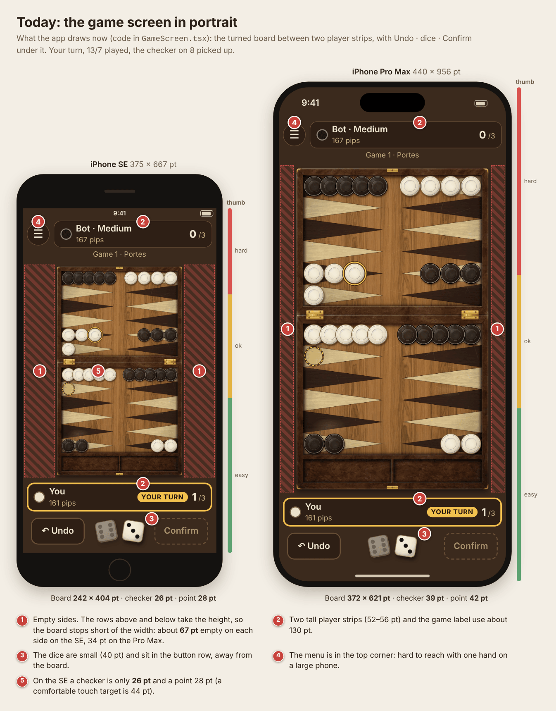
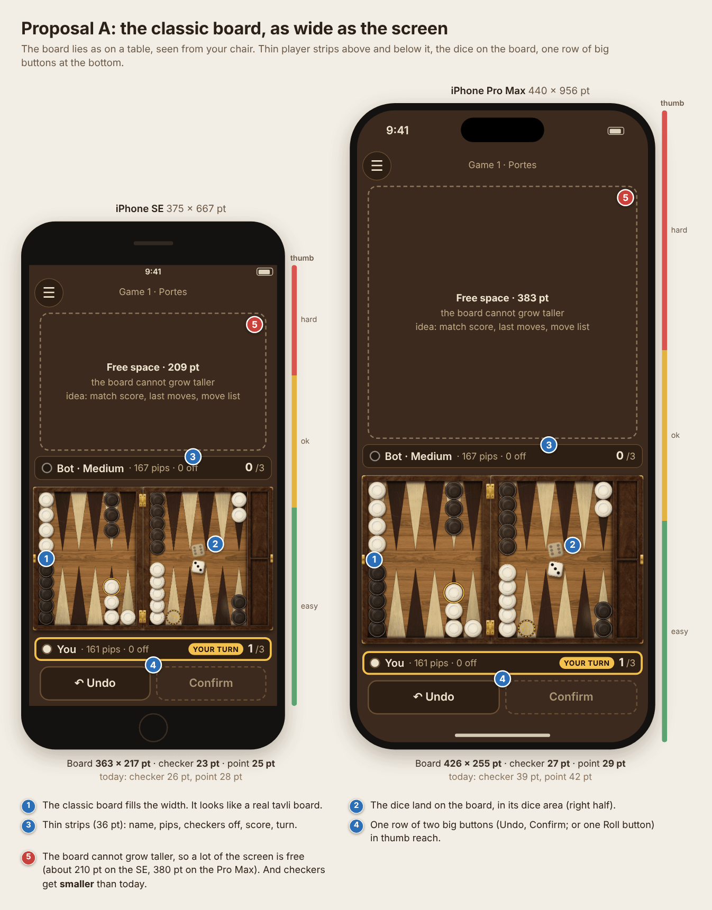
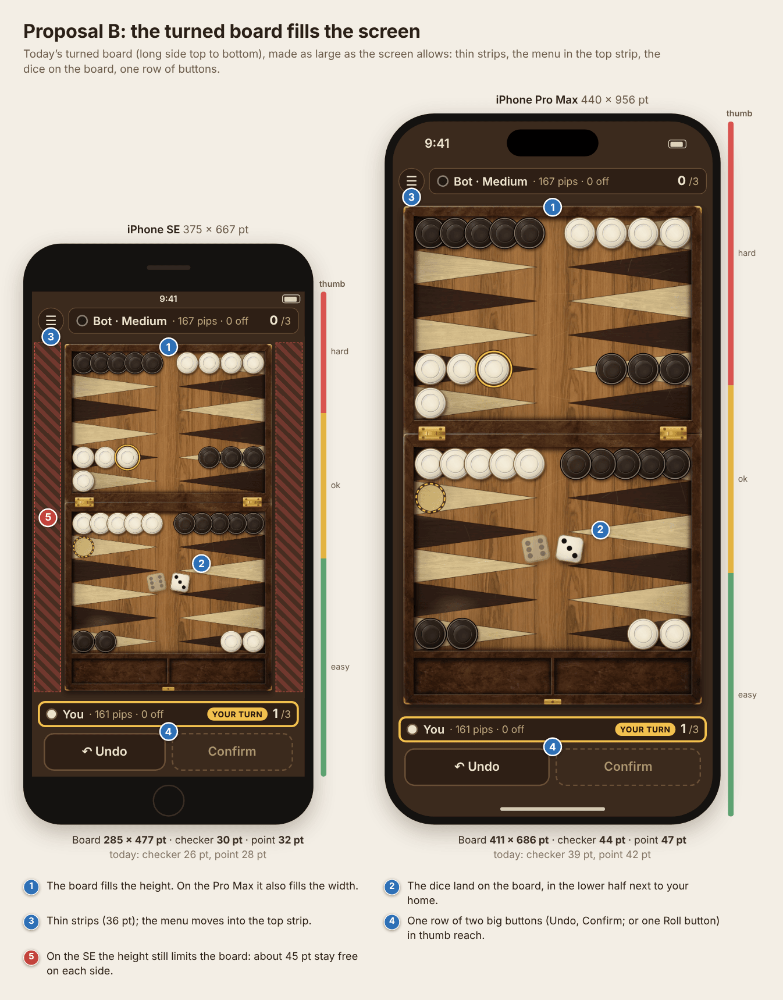
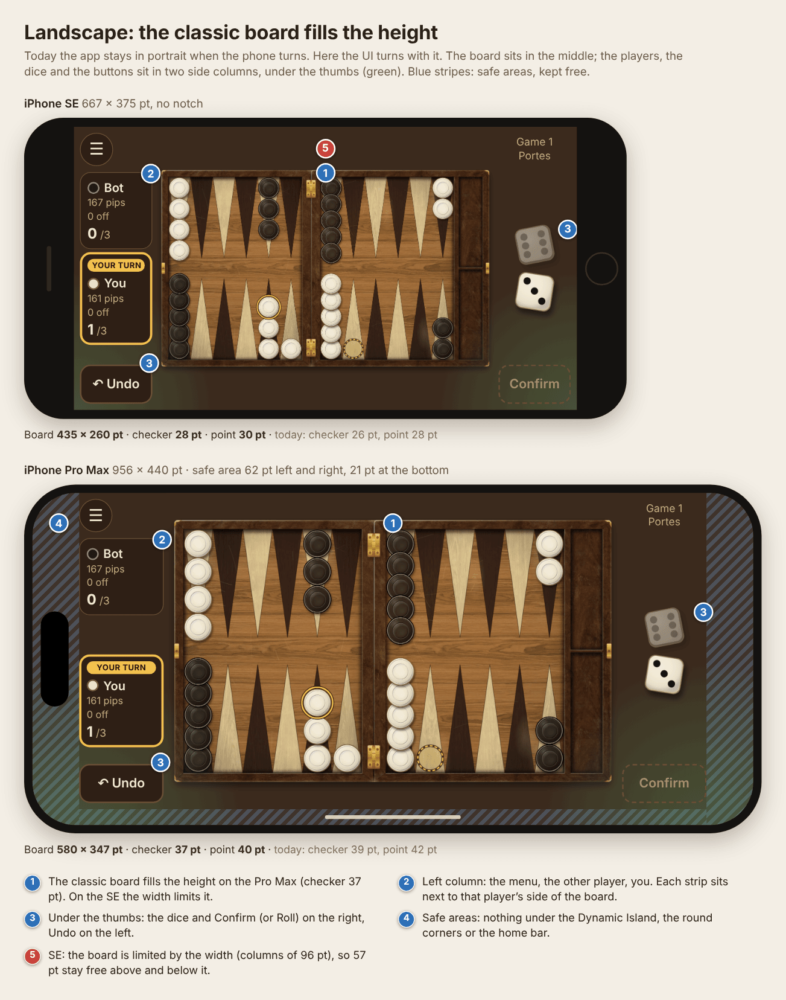

# Game screen layout: proposals

> Issues #184 (portrait) and #185 (landscape), step 1. These are pictures for the owner to pick from. The app does not change yet. Last review: 2026-10-27.

## How to read the pictures

- The **board is real**: the app's own `BoardScene` in Walnut Kafeneio, drawn headless (like `pnpm --filter @tavli/mobile screenshots`) at the exact size each layout gives it (`fitBoardWithShadow`). So the board, checker and point sizes are real numbers.
- The strips, buttons and phone frames are HTML with the app's colors and text sizes (`packages/ui`). Text is English; Greek is longer (see the [Greek length check](wireframes.md#greek-length-check)).
- Two phones: **iPhone SE** (375 × 667 pt, the smallest we support) and **iPhone Pro Max** (440 × 956 pt).
- The position: Portes, your turn, 6-3. You played 13/7 with the 6 and picked up the checker on 8; its target is lit.
- **Red pins** mark problems. **Blue pins** mark what a proposal does. The color bar next to each phone is a rough guide to one-hand thumb reach.
- **Point** = how wide one point is across (the size you aim at). A comfortable touch target is 44 pt.

## Sizes at a glance

| Layout                    | SE board  | SE checker | SE point  | Pro Max board | Pro Max checker | Pro Max point |
| ------------------------- | --------- | ---------- | --------- | ------------- | --------------- | ------------- |
| Today                     | 242 × 404 | 26 pt      | 28 pt     | 372 × 621     | 39 pt           | 42 pt         |
| A: classic board in width | 363 × 217 | 23 pt      | 25 pt     | 426 × 255     | 27 pt           | 29 pt         |
| B: turned board, full     | 285 × 477 | **30 pt**  | **32 pt** | 411 × 686     | **44 pt**       | **47 pt**     |
| Landscape                 | 435 × 260 | 28 pt      | 30 pt     | 580 × 347     | 37 pt           | 40 pt         |

## Today

The app uses the turned board (wireframe option B): the long side runs top to bottom. Around it are a menu button, the other player's strip, the game label, your strip and the controls row (Undo · dice · Confirm).

What wastes space or is hard to reach:

1. **Empty sides.** The rows above and below the board use about 220 pt of the height on the SE. The board keeps its shape, so it stops short of the width: about 67 pt stay empty on each side on the SE, 34 pt on the Pro Max.
2. **Tall strips.** Each player strip has two lines (52–56 pt). With the game label they use about 130 pt.
3. **Small dice, far from the board.** The dice are 40 pt and sit in the button row.
4. **The menu** is in the top left corner. On a large phone you need two hands for it.
5. **Small checkers on the SE**: 26 pt, with 28 pt points. The 22 pt tap snap helps, but drags are tight.
6. Not drawn: with the **move list** on (screen readers, #134) one more row sits under your strip, so the board gets smaller still.
7. **Landscape:** `app.json` locks the app to portrait. When you turn the phone, nothing turns.

## Proposal A: the classic board, as wide as the screen

The board lies as on a table, seen from your chair (the theme's `landscape` layout). Thin one-line strips sit right above and below it, the dice land on the board, and one row of two big buttons sits at the bottom.

Pros:

- It looks like a real tavli board. The top row is the other player's side, the bottom row is yours.
- The same board as in landscape and in face-to-face play, so a player sees one board everywhere.
- The board, the dice and the buttons are all in the lower half, in thumb reach.

Cons:

- **Checkers get smaller than today**: 23 pt on the SE (today 26), 27 pt on the Pro Max (today 39). Points are 25–29 pt.
- The board cannot grow taller, so a big part of the screen is free: about 210 pt on the SE, 380 pt on the Pro Max. We need a use for it (match score, last moves, the move list) or it looks empty.
- The wireframes (#14) chose the turned board for exactly this reason. Picking A changes that choice.

## Proposal B: the turned board fills the screen

Today's turned board, made as large as the screen allows. The strips become one line (36 pt), the menu moves into the top strip, the game label goes into the menu, the dice land on the board, and one row of two big buttons sits at the bottom.

Pros:

- **The biggest checkers**: 30 pt on the SE, 44 pt on the Pro Max (today 26 and 39).
- On the Pro Max the board fills the width and the height.
- A small change: the same board layout, art, hit tests and flights as today. Only the views around the board change.
- The dice land on the board, near your home.

Cons:

- It does not look like a board seen from your chair (the same as today).
- On the SE the height still limits the board: about 45 pt stay free on each side.
- Dice on the board use the theme's dice size: 25 pt on the SE and 36 pt on the Pro Max, smaller than today's 40 pt. The theme can make them larger.
- With a large font the one-line strips grow to two lines. That is fine, but the board gets smaller.

## Landscape: the classic board fills the height

The UI turns with the phone. The classic board sits in the middle. The left column holds the menu, the other player and you, each next to that player's side of the board. The right column holds the game label, the dice and Confirm (or Roll). Undo sits under the left thumb, Confirm under the right thumb.

- On the Pro Max the board fills most of the height: checkers 37 pt. The safe areas (62 pt left and right for the Dynamic Island and round corners, 21 pt at the bottom for the home bar) stay free.
- On the SE the width limits the board (two 96 pt columns): checkers 28 pt, with 57 pt free above and below.
- All three themes already have a `landscape` layout with its own images, and the board code already handles both layouts (`boardModel.test.ts` checks both). So the board itself needs little new work.

Points to solve when we build it:

- Greek "Επιβεβαίωση" is about 102 pt at 17 pt. It does not fit a 96 pt column on the SE. We need a smaller text, an icon with a label, or wider columns (a smaller board).
- Every card and sheet (opening, pass, mother, game end, menu, resign) must fit 375 pt of height or scroll.
- Turning the phone mid-turn must keep the dice, the moves made and a picked-up checker.

## How the proposals fit together

- **B in portrait + the landscape proposal** gives the biggest checkers in portrait and the classic look when you turn the phone. Our suggestion.
- **A in portrait + the landscape proposal** gives the classic board everywhere, but with small checkers in portrait.
- Face-to-face play (phone flat between two players) needs the classic board anyway, so it can reuse A's layout later.

## Open questions for the owner

1. **Portrait:** A, B, or keep today's layout?
2. **Which screens turn in landscape?** (a) only the game board and the tutorial board, or (b) every screen. Suggestion: (a). Home, New game, Settings and Rules stay in portrait, so we test fewer layouts.
3. **Landscape sides:** players on the left and the dice on the right, as drawn? Do left-handed players need a "swap sides" setting?
4. **Dice:** on the board (A, B) or in the button row (today)? On the board they are smaller unless we raise the theme's dice size.
5. **Proposal A only:** what goes into the free space: the match score, the last moves, the move list, or nothing?
6. **Strips:** one line is enough (name, pips, checkers off, score, turn)? The match score and "checkers off" can also move to the menu.
7. **Rotation lock:** the phone's own rotation lock is always respected. Do we also want an in-app "keep portrait" setting?

## How the pictures were made

A one-off script, not kept in the repo: the board images come from `BoardScene` with the headless Skia renderer at 3× (the same setup as `apps/mobile/tools/screenshots/`). An HTML page per picture places them in the phone frames, and Playwright Chromium renders it at 1.25×. The PNGs are then reduced to 128 colors (libimagequant, like pngquant) to stay under 400 KB each. To change a picture, ask for a new render or redraw it from these notes.
