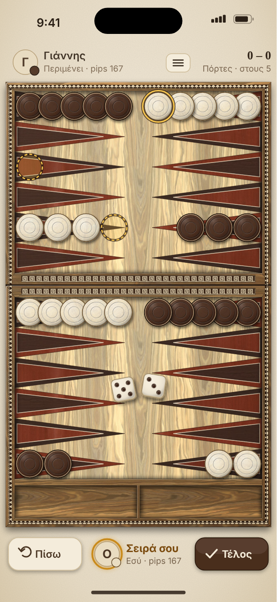
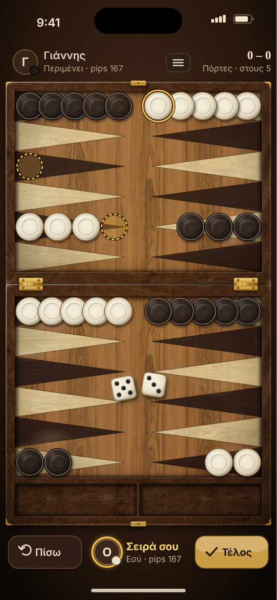
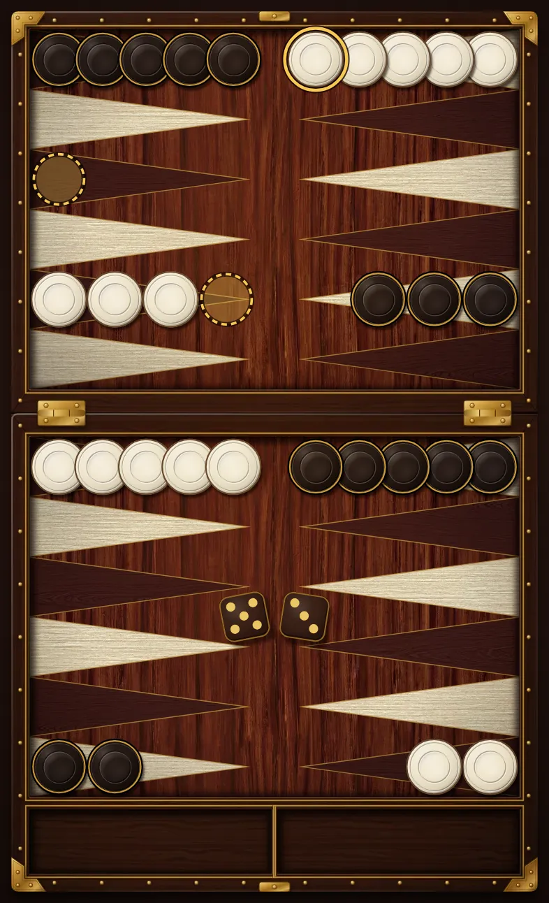
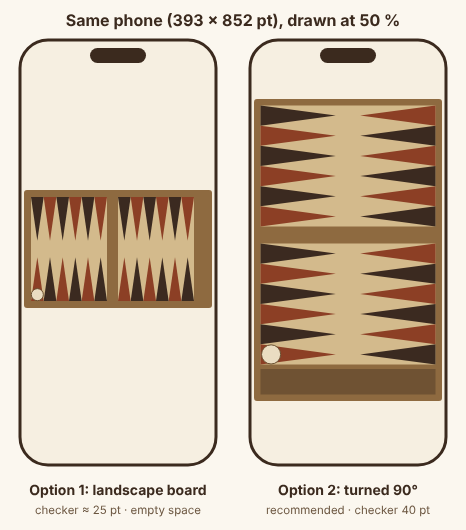

# Board style: two wooden concepts

> Issue #13. Owner decision (2026-10-26): **traditional wooden style only**, kafeneio feel. Last review: 2026-10-26.
> Status: decided. Concept B shipped first as `walnut-kafeneio`. Concept A shipped as the second board, `olive-inlay` (issue #138). A third, dark board, `kafeneio-night` (issue #144), came after the two concepts. The player picks one in Settings → Board.

Both mockups show the same moment: a Portes game at the start position. You have the light checkers and rolled 5-3. You tapped the top checker on your point 13, so points 10 and 8 show as legal targets. Undo and Confirm are drawn enabled so you can see their style.

<table>
<tr>
<td align="center"><b>A. Olive inlay</b><br></td>
<td align="center"><b>B. Walnut kafeneio</b><br></td>
</tr>
<tr>
<td align="center"><a href="concept-a-olive-inlay@3x.webp">full size 1179 × 2556</a></td>
<td align="center"><a href="concept-b-walnut-kafeneio@3x.webp">full size 1179 × 2556</a></td>
</tr>
</table>

## Files

| File | What |
|------|------|
| [`mood-board.md`](mood-board.md) | 15 linked references and what we take from each |
| [`palette.md`](palette.md) | Color tokens, checker contrast, color-blind check, dice style |
| [`LICENSES.md`](LICENSES.md) | Texture sources (all CC0) and credits |
| `concept-*.png` | Mockups, 590 × 1278 (half of @3x) |
| `concept-*@3x.webp` | Full-size mockups, 1179 × 2556 |
| `orientation.png` | Sketch of the two orientation options |
| `olive-inlay-theme.webp` | Concept A as built: the `olive-inlay` theme rendered from its manifest (`packages/themes/preview/olive-inlay.png`, 786 × 1292) |
| `kafeneio-night-theme.webp` | The third board, `kafeneio-night` (issue #144), rendered from its manifest (`packages/themes/preview/kafeneio-night.png`, 786 × 1292). See below. |
| `src/build.js` | Generates the SVGs and renders the PNGs (Node + Playwright Chromium) |
| `src/concept-a.svg`, `src/concept-b.svg`, `src/orientation.svg` | Generated SVG sources |
| `src/prepare_textures.py` | Downloads and grades the CC0 wood textures |
| `src/contrast.py` | Contrast and color-blind numbers for `palette.md` |
| `textures/` | 10 graded CC0 wood textures (650 KB total) |

## Third board: Kafeneio Night

Issue #144 adds a dark board for the evening, in the same wooden style: a deep mahogany field, a black walnut frame with brass corner plates, nails, hinges and stringing, rosewood and pale ash points, ivory and ebony checkers (a brass ring on the ebony ones) and dark dice with gold pips. It has no mockup; the theme render is the reference. Tokens and contrast are in [`palette.md`](palette.md#kafeneio-night) and in `packages/themes/README.md`.



## Orientation: turn the board 90°

A real tavli board is wider than tall, and the players sit on the long sides. A phone is tall. There are two ways to fit it:



| | Option 1: landscape board inside portrait | Option 2: board turned 90° (**recommended**) |
|-|------------------------------------------|---------------------------------------------|
| Board size on a 393 × 852 pt phone | about 377 × 236 pt | 377 × 630 pt (74 % of the screen height) |
| Point width / checker | about 25 pt | 42.9 pt / 40 pt |
| Touch | Under Apple's 44 pt guide. Drags need precision. | Tap targets are a full point: 43 × 156 pt. |
| Looks like a real board | Yes, from a player's seat | It looks like the board seen from its end |
| Empty screen space | Over half the screen | Little; HUD fits above and below |
| Thumb reach | Board is mid-screen | Both homes, both trays and the buttons are at the bottom |

**Recommendation: Option 2.** Layout used in the mockups:

- Left column, top to bottom: your points 12 → 7, bar, 6 → 1. Right column: 13 → 18, bar, 19 → 24.
- You move up the right column, across the top, and down the left column. Your home is bottom-left. You bear off into the bottom-left tray. The opponent's home and tray are bottom-right.
- The bar is the fold of the box: two rails with a seam (hinges in B).
- The bear-off slot sits at the home end, like Greek boards "with slots" (mood board #2).

What this decides for later work:

- `theme.json` gets `"orientation": "portrait-rotated"` and a layout for it. Tablets and landscape phones can use a normal landscape layout. Layout is data (ADR-0005), so this is a second layout, not new code.
- The Blender skin (v1.0) must be lit for this orientation. Both mockups use light from the top-left of the phone screen. Do not rotate a pre-rendered image.
- A setting mirrors the board (on screen: home bottom-right) for players who learned on a board with the home on the bottom left: Settings → Board → Your home (#175). The art is not mirrored, so the light stays top-left; layouts must be left–right symmetric.

## Concept A: olive inlay

Light olive wood, inspired by Greek olive-wood boards (mood board #6, #13).

- **Field:** light olive with dark wavy streaks. Grain runs along the board.
- **Points:** inlaid triangles of wenge and mahogany. Each point has a core of the other wood and thin maple stringing. Points facing each other use different woods.
- **Frame:** darker streaky olive, mitered corners, a dog-tooth banding all round.
- **Bar:** two Greek key (meander) bands, one on each half of the fold.
- **Checkers:** turned wood with two grooves. Cream maple and dark walnut. Dark checkers have a light polished edge ring.
- **Dice:** bone-cream with walnut pips.
- **UI:** warm cream background, dark brown text, walnut Confirm button.

| Pros | Cons |
|------|------|
| Most "Greek" at a glance: olive wood plus the meander | Busier. The two-wood points and banding compete a little with the checkers. |
| Light and fresh; fits daytime and island summer | Cream checkers on the light field rely on their dark outline (field contrast 1.4:1, outline 3.9:1). |
| Shows craft (inlay, stringing) that a vector theme can do well | A light screen is brighter at night and uses more power on OLED. |
| Easy to vary (other woods, other bandings) | Fine inlay detail needs care at @1x on small Android phones. |

## Concept B: walnut kafeneio

The board that sits on a kafeneio table for 30 years (mood board #1, #3, #4).

- **Frame, bar, trays:** dark, worn walnut. Lighter rubbed corners, light scratches, a faint old coffee ring.
- **Field:** mid walnut, warm. Rubbed spots near the point bases where hands slide checkers.
- **Points:** ebony and aged bone, plain. Points facing each other use different woods.
- **Brass:** two hinges on the fold, clasp plates at both ends, corner caps.
- **Light:** a warm overhead lamp; the edges of the screen fall into shadow.
- **Checkers:** resin with a dished centre. Ivory and black. Black checkers have a grey polished edge ring.
- **Dice:** old ivory with black pips and a red ace pip.
- **UI:** dark warm brown background, cream text, brass Confirm button.

| Pros | Cons |
|------|------|
| Strongest kafeneio mood; matches the app name "Kafeneio Backgammon" | Dark overall. Needs care so the board never looks muddy on a dim phone. |
| Calm field and plain points: the checkers stand out most | Black on ebony points relies on the edge ring (fill 1.1:1, ring 4.3:1). |
| Best checker contrast: 13.4:1 (tokens), 12.7:1 measured | Wear and scratches must stay subtle, or the board looks dirty. |
| Dark UI is easy on the eyes at night and saves OLED power | Less unique than A; many walnut boards exist. |
| Matches the planned v1.0 Blender "Kafeneio Classic" skin (walnut box, brass hinges) | Brass and lamp effects are harder to keep consistent in a vector theme. |

## Recommendation

**Pick Concept B (walnut kafeneio) as the first theme.** It is the calmest board, it has the best checker contrast, and it is the clearest "kafeneio" signal. It also leads straight into the v1.0 Blender skin planned in `art-pipeline.md` §3.1.

Keep **Concept A as the second theme** (the art pipeline plans two bundled themes). A good extra: borrow A's meander band as an optional inlay on B's bar.

## What the owner must decide

1. **Concept:** A, B, or B first with A as the second theme (recommended).
2. **Orientation:** board turned 90° with both homes at the bottom (recommended), or a landscape board.
3. **Checkers for B:** ivory and black (recommended), or red and cream. Red fails contrast on walnut (1.35:1) and clashes with brown for red-blind players; see `palette.md`.
4. **Labels:** Greek only (as in the mockups: "Σειρά σου", "Πίσω", "Τέλος") or Greek with English.
5. **Wear level in B:** as shown, less, or more.

## Rebuild

```sh
# 1. Textures (only if the grade changes). Downloads go to a cache folder.
python3 docs/design/style/src/prepare_textures.py --download /tmp/tex-cache
python3 -I docs/design/style/src/prepare_textures.py /tmp/tex-cache

# 2. SVGs and PNG previews (needs `playwright` with Chromium).
MASTER_DIR=/tmp/masters node docs/design/style/src/build.js

# 3. Full-size WebP from the @3x masters.
python3 -c "from PIL import Image
for n in ['concept-a-olive-inlay','concept-b-walnut-kafeneio']:
    Image.open(f'/tmp/masters/{n}@3x.png').convert('RGB').save(f'docs/design/style/{n}@3x.webp', quality=86, method=6)"

# 4. Contrast numbers for palette.md.
python3 -I docs/design/style/src/contrast.py
```

Notes for the Skia build:

- Each wood is an image shader (tiled CC0 texture) plus a token color. The mockups bake the color into the texture. Skia can apply it at runtime with a color filter instead.
- Checker shadows, the fold seam, the frame's inner shadow and the sheen are simple blurs and gradients. Skia draws all of them.
- The SVGs use points (pt). Divide by the board size to get the normalized layout for `theme.json`.
