# Wireframes: core MVP1 screens

> Status: draft for owner review (issue #14). Last review: 2026-10-27.
> These are low-detail, grayscale layouts. They are **not** final art. The wooden style comes from #13 and #38.

## How to read this doc

- Every screen is drawn at **390 × 844 pt** (a standard modern iPhone, portrait).
- Sources are SVG files in [`wireframes/`](wireframes/). Each one has a PNG render next to it (2× scale, grayscale). Edit the SVG, then render the PNG again (for example with Playwright's Chromium at `deviceScaleFactor: 2`).
- **Dark filled button** = main action. **Outlined** = second action. **Dashed** = disabled or locked. **Thick outline** = selected or active.
- Small white boxes with a thin border (for example "Checker 36 pt") are **notes for the reader**, not UI.
- Texts are English placeholders. Final strings live in the `en` and `el` files (#37).

## Design rules for all screens

1. **Thumb reach.** Main actions sit in the lower half of the screen (below y ≈ 420). The top holds only back, menu and settings.
2. **Touch targets** are at least **44 × 44 pt**. Main buttons are 52–64 pt tall and full width.
3. **Greek text is longer.** Sentences grow about 20–30%. Short labels grow much more (see the [Greek length check](#greek-length-check)). So:
   - No fixed-width text boxes. Buttons are full width or at least 104 pt wide.
   - List rows and helper texts can wrap to 2 lines.
   - Font size never drops below 12 pt to make text fit.
   - Greek all-caps labels drop the accent (tonos): "ΠΑΙΧΝΙΔΙ", not "ΠΑΙΧΝΊΔΙ". React Native does not do this for us. Write caps labels in the translation file, or use a small helper.
4. **The board has no words.** Only numbers (count badges) and the BAR mark. All text sits in the strips and controls, where we have room.
5. **Safe areas.** Keep content out of the status bar (top ~47 pt) and the home indicator (bottom ~34 pt).
6. **Colour is never the only cue.** Legal targets use a dashed outline plus a "ghost" checker. Turn state uses a thick border plus a text pill.
7. Colours, fonts and radii are placeholders. Real values become theme tokens (ADR-0005).

## Route map (Expo Router)

| Screen | Route file | How it opens |
|---|---|---|
| Root layout | `app/_layout.tsx` | Loads settings and the saved game while the splash shows. Sends a first-time user to `/welcome/language`. |
| First launch: language | `app/welcome/language.tsx` | Stack, no back button |
| First launch: usage data | `app/welcome/privacy.tsx` | Stack |
| Home | `app/index.tsx` | Root of the stack |
| New game | `app/new-game.tsx` | Push, with param `mode=bot` or `mode=local` |
| Board | `app/game/[id]/index.tsx` | Push |
| In-game menu | `app/game/[id]/menu.tsx` | Modal, `presentation: "formSheet"` |
| Game end | — | Overlay state inside the board screen, so the final position stays visible |
| Match end | `app/game/[id]/match-end.tsx` | `router.replace`, so "back" does not return to a finished board |
| Game review | `app/game/[id]/review.tsx` | Push from the game-end sheet or match end (#215). Not drawn here; see `docs/architecture/board-screen.md`, "Game review". |
| Settings | `app/settings.tsx` | Push from Home; modal from the in-game menu |
| Tutorial | `app/tutorial.tsx` | Push from the Home card, Settings or the Portes rules page (#128); the Plakoto, Fevga and Asodio rules pages open their own lessons (`?game=`, #149, #159), and Settings → Help lets the player pick the game (#159). Not drawn; see the note under Home. |
| Rules | `app/rules/[variant].tsx` (e.g. `/rules/portes`) | Push. Not drawn here; a scrolling text page with a small start board (`docs/architecture/app-shell.md`, "Rules pages"). |
| Dialogs (resign, no moves, mother pinned, replace saved game) | — | Components, not routes |
| Dev online game | `app/dev/online.tsx` | Dev builds only (#255): starts an online game vs the bot on the in-memory server, then pushes the board. Not drawn. |

`[id]` is a local game id in MVP1 (for example `local-<uuid>`). Online games in MVP2 use the server id with the same route: an id that does not start with `local-` opens the online screen (#255).

## User flow

### App flow: open → game → match end → rematch or home

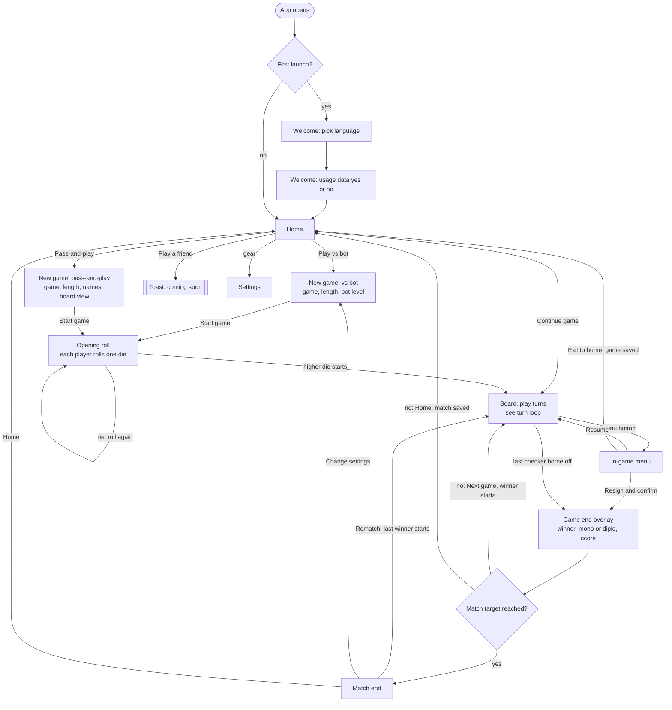

### Turn loop inside the board screen (vs bot and pass-and-play)

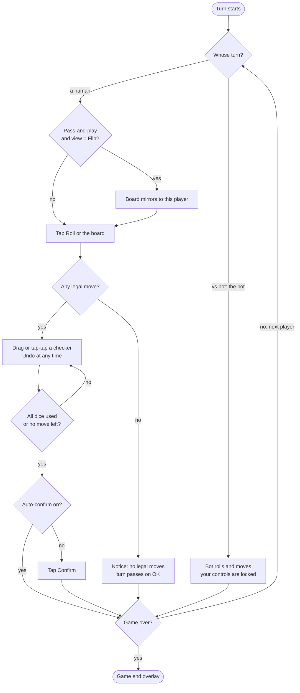

Notes:

- "Change settings" opens the new-game screen of the same mode (vs bot or pass-and-play), filled with the last choices.
- A 1-point match skips the game-end overlay and goes straight to match end.
- A rematch has no opening roll. The winner of the last game starts (`rematchStarter`, `docs/rules/tavli-match.md`).

---

## 1. First launch: language

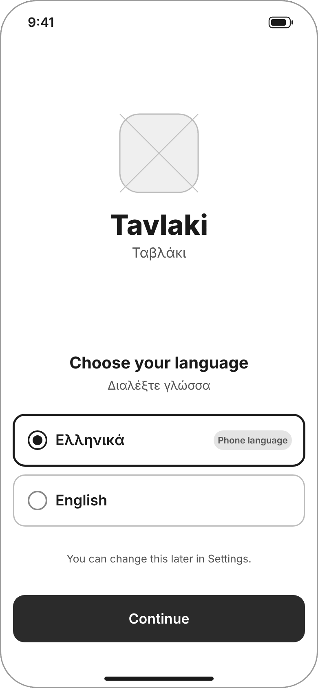

- **Route:** `app/welcome/language.tsx`
- **Purpose:** Pick Greek or English before any other text. Shown once.
- **Elements:**
  - Logo placeholder, app name "Tavlaki" and "Ταβλάκι".
  - Title in both languages ("Choose your language" / "Διαλέξτε γλώσσα").
  - Two large option cards: **Ελληνικά**, **English**. Each language name is written in its own language.
  - The phone's language is pre-selected and marked "Phone language". If the phone is in neither language, English is pre-selected.
  - Note: "You can change this later in Settings."
  - **Continue** (main button).
- **States:** No loading or error. The screen switches language as soon as the user taps a card.
- **Goes to:** Usage data screen.

## 2. First launch: usage data consent

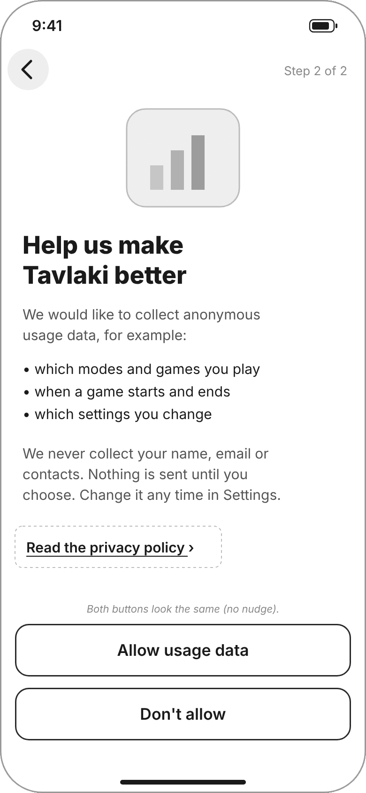

- **Route:** `app/welcome/privacy.tsx`
- **Purpose:** Ask for opt-in to anonymous analytics (GDPR, #61). **No usage events are sent before the user chooses.** Only anonymous crash reports (no install id) are sent before the answer. This is the one privacy switch: **Don't allow** also stops crash reports.
- **Elements:**
  - Back button (to language) and "Step 2 of 2".
  - Simple picture placeholder.
  - Title "Help us make Tavlaki better".
  - What we collect, in plain words (modes and games played, game start and end, settings changed, crash reports).
  - What we never collect (name, email, contacts). That until the choice only anonymous crash reports are sent, and that "Don't allow" turns off usage data and crash reports. "Change it any time in Settings."
  - Link "Read the privacy policy" (opens `tavlaki.com/privacy` in an in-app browser).
  - Two buttons with the **same look and size**: **Allow usage data** and **Don't allow**. No button is more prominent. Refusing must be as easy as accepting.
- **States:** If the app closes before a choice, no usage data is sent (crash reports stay anonymous) and the screen shows again on next launch.
- **Goes to:** Home. The choice is saved; Settings → "Share usage data" reflects it.

## 3. Home

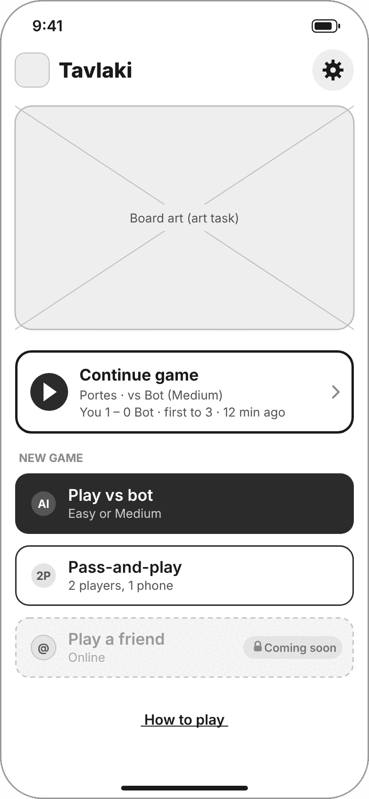
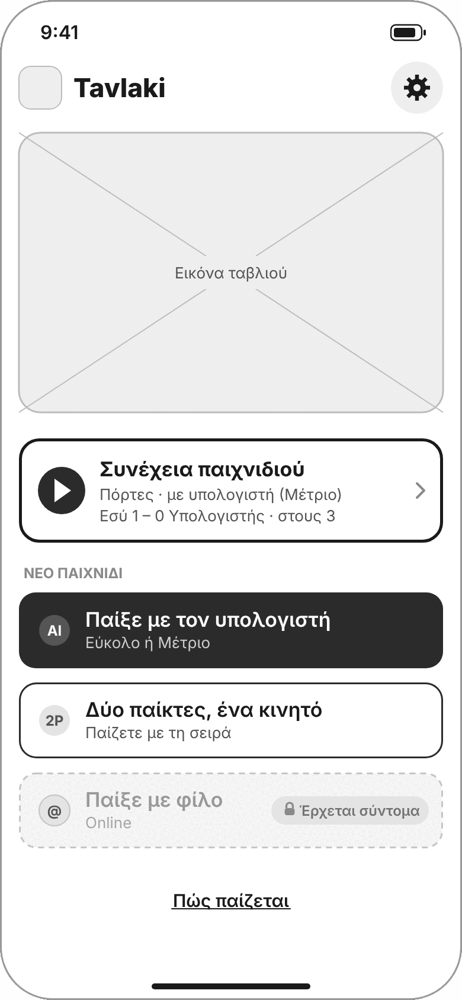

- **Route:** `app/index.tsx`
- **Purpose:** Start or continue a game in one or two taps (#34, #36).
- **Elements:**
  - Top bar: small logo, "Tavlaki", **gear** button (Settings).
  - Board art or mascot area (filled by the art task).
  - **Continue game** card (only when a saved game exists): game, opponent, match score, target and time since last move. The whole card is one target.
  - **Learn to play** card (#128, not drawn): title, one line, **Start the lesson** (filled) and **Not now** (text). Shows until the tutorial is finished or dismissed.
  - "New game" section:
    - **Play vs bot** (main button). The subtitle lists the bot levels, for example "Easy, Medium or Hard". The app builds it from the levels the bot plays in at least one game (#182).
    - **Pass-and-play** (subtitle "2 players, 1 phone").
    - **Play a friend** (disabled look, "Coming soon" chip).
  - **How to play** link (opens `/rules/portes`).
- **States:**
  - *No saved game:* the Continue card is hidden and the art area grows.
  - *Saved game:* Continue card shows. MVP1 keeps **one** saved game.
  - *Loading:* the native splash stays until settings and the save are read. This is local and fast, so there is no spinner.
  - *Saved game broken or too old:* it is dropped safely (#36). A one-time toast says "Your saved game could not be opened."
  - *Play a friend tapped:* toast "Coming soon: play friends online." No navigation. The button keeps a full-size target so the tap gives feedback.
- **Goes to:** Board (continue), New game (`mode=bot` or `mode=local`), Settings, Rules, Tutorial.

### Note: first-run tutorial (#128, not drawn)

Route `app/tutorial.tsx`, pushed from the Home card, Settings → Help or the Portes rules page (the Plakoto, Fevga and Asodio rules pages open their own four lessons, #149, #159; Settings → Help asks which game). Same layout rules as the board screen:

- Top bar: "Learn to play", "Lesson 2 of 7" under it, **Skip** (text button, at least 44 pt) on the right. Always shown.
- A lesson card under the top bar: the lesson title, one line of text, then the hint (after a wrong touch) or the success line. A wrong touch shakes the card (not with Reduce motion).
- The real board fills the middle. The checker to touch has the selected ring; after a tap, its target has the dashed ring and the ghost.
- Controls row: the lesson's dice (used dice fade) and, after success, **Next** (main button, full width in the row).
- End: "You know the basics!", **Play your first game** (main) and **Home** (text). The board is gone; a small celebration shows.
- Details: [App shell, Tutorial](../architecture/app-shell.md#tutorial-128).

## 4. New game: vs bot

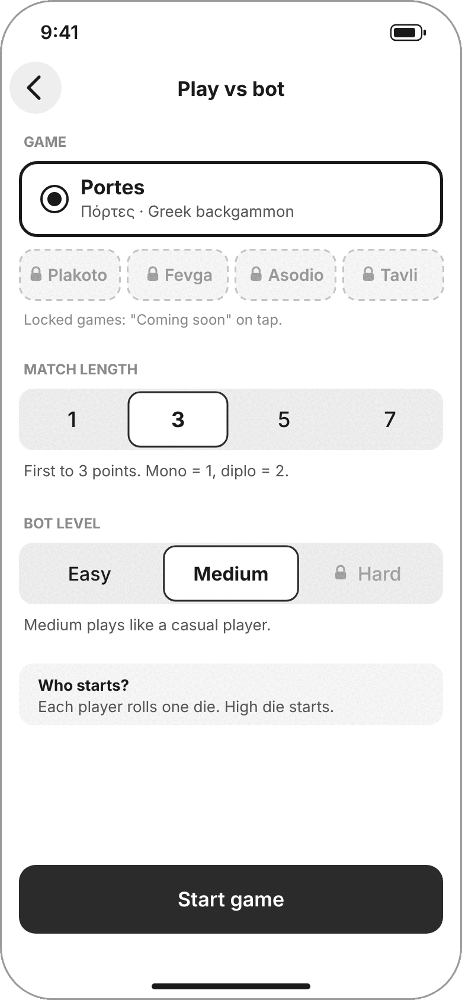

- **Route:** `app/new-game.tsx?mode=bot`
- **Purpose:** Choose game, match length and bot level, then start.
- **Elements:**
  - Back button, title "Play vs bot".
  - **Game:** one card per open game: Portes (selected by default), Plakoto, Fevga, Tavli (all three in rotation) (#109). A game the bot cannot play yet, and Asodio (not built), show as locked chips. A tap on a locked chip shows "Coming soon".
  - **Match length:** segmented control **1 / 3 / 5 / 7**, default **3**. Helper text: "First to 3 points. Mono = 1, diplo = 2." With Asodio's **American** version: "First to 3 points. 1 point per checker left." (#245).
  - **Bot level:** **Easy / Medium / Hard**. A level the bot cannot play in the chosen game shows locked, with "coming soon" under it. Helper text explains the selected level.
  - Info box "Who starts? Each player rolls one die. High die starts." Since #207 the **House rules** part (below) replaces it: its hint says who starts under the chosen rule.
  - **House rules** (#207, both modes): **Opening roll**: **Standard** (default, the federation rule: the starter plays the two opening dice) / **Roll again** (the starter rolls both dice again) / **Choose** (the players pick who starts). Helper text explains the selected rule.
  - **Rules version** (#241, Plakoto and Asodio only, under Opening roll): Plakoto **Standard** (default) / **Federation**; Asodio **Standard** (default, the kafeneio rules) / **Greek** / **American** (Acey-Deucey). Helper text says what the selected version changes. Tavli shows the Plakoto choice for its Plakoto game, titled **Rules version (Plakoto)** («Παραλλαγή (Πλακωτό)», #247). Portes and Fevga show no version.
  - Both groups have a **Standard** option, so a screen reader hears the group with each option: "Opening roll: Standard", "Rules version: Standard" («Πρώτη ζαριά: Κανονικά», «Παραλλαγή: Κανονική») (#243). The visible text stays short.
  - **Start game** (main button, bottom).
- **States:**
  - The screen remembers the last choices. On the very first game the bot level is Easy.
  - *A saved game exists:* Start shows a dialog "Start a new game? Your saved game will end." with **Start new** and **Cancel**.
- **Goes to:** Board (opening roll). Back goes to Home.

## 5. New game: pass-and-play

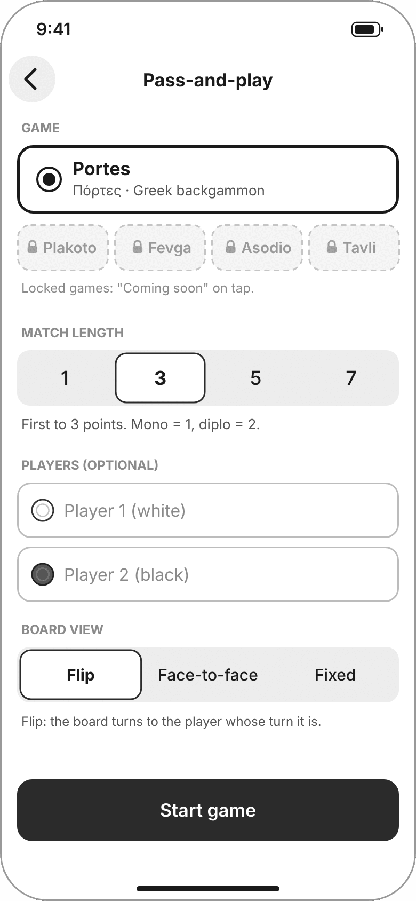

- **Route:** `app/new-game.tsx?mode=local`
- **Purpose:** Same as vs bot, plus player names and board view (#35).
- **Elements:**
  - Game and match length, as on screen 4.
  - **Players (optional):** two text fields with the checker colour shown. Empty fields become "Player 1" and "Player 2". Max 16 characters.
  - **Board view:** **Flip / Face-to-face / Fixed**. Default comes from Settings. Helper text explains the selected view.
  - **Start game**.
- **States:** When the keyboard is open, the form scrolls and Start stays above the keyboard.
- **Goes to:** Board (opening roll).

## 6. Board

- **Route:** `app/game/[id]/index.tsx`
- **Purpose:** Play the game. This is where players spend 95% of their time.
- **Layout (top to bottom)**, Settings → Board → Board layout **Tall** (default since #184):
  1. **Menu button** (36 pt circle, 44 pt touch area) inside the row of the **opponent strip**: name and match score ("0 /3"), on one line (36 pt).
  2. **Board**, rotated 90° (see [Board layout](#board-layout-recommendation)), as large as the screen allows. Bear-off trays sit at the bottom of the board. The **dice** lie on the board, in the theme's dice area.
  3. **Your strip**: name, match score, turn pill, on one line.
  4. **Controls**: one row of two big buttons, Undo · Confirm, or one big Roll button.
  - The game label ("Game 2 · Plakoto") is in the menu.
- **Classic** layout (a setting, #184): the board as on a table, as wide as the screen, with its strips right above and below it, centred on the screen. The menu and the game label sit at the top; the buttons stay at the bottom. Pictures: [game-layout-proposals.md](game-layout-proposals.md) (proposal A, but centred).
- The pictures below are the first layout (before #184): two-line strips and the dice between Undo and Confirm. They also show a pip count ("Pips 167"), which the app no longer has (#238). The states they show are the same.
- **Turn indicator:** the active player's strip gets a thick border and a pill ("YOUR TURN", "PLAYING", or the player's name in pass-and-play).
- **No pip count:** the strips show no pip count, and Settings has no switch for it. The owner removed it (#238, Q19 in `docs/open-questions.md`).
- **Count badge:** a stack of more than 5 checkers shows 5 checkers and a number badge on the last one (#29).

### 6a. Opening roll

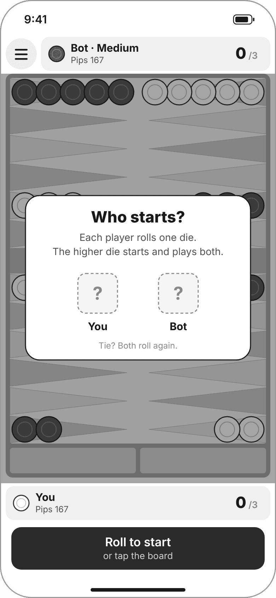

- Card over the dimmed starting position: "Who starts?", two empty dice for **You** and **Bot**.
- One tap on **Roll to start** (or on the board) rolls one die for each player.
- *Tie:* "Tie: both rolled 4. Roll again." Both dice stay on the card until the next roll (#176).
- *Result:* "You start with 5-3." The card closes on OK, on a tap, or after 3 s (#176). The starter plays those two dice (`useOpeningDice`, so the first roll is never a double).

### 6b. Your turn: roll

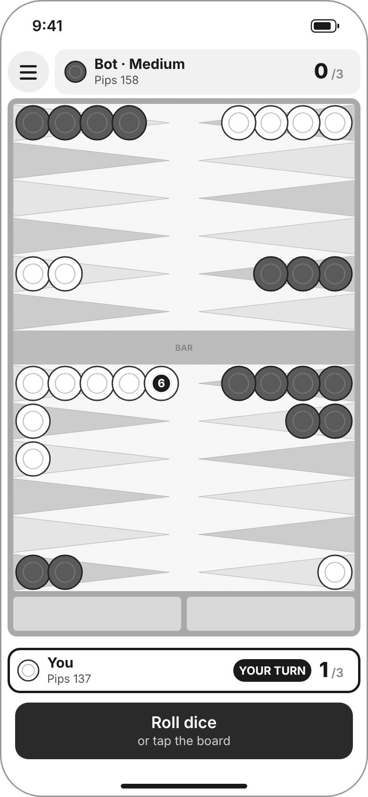

- One big **Roll dice** button ("or tap the board"). Undo and Confirm are hidden.
- The stack on point 6 shows the count badge "6".

### 6c. Your turn: moving

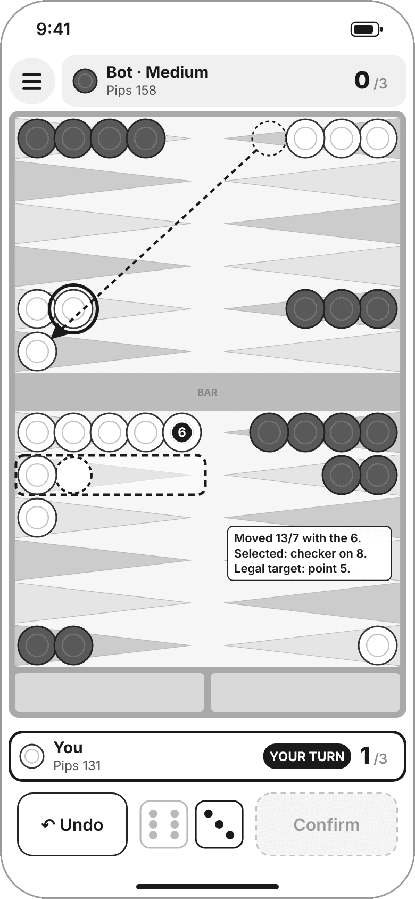

- Dice sit between Undo and Confirm (since #184: on the board). A used die fades (#30). Here the 6 is used (13/7) and the 3 is left.
- Touch a checker that can move: it gets a ring. Its legal target points get a dashed outline and a ghost checker (#31).
- **Drag** to a target, or **tap** the checker and then the target. A drop on an illegal point returns the checker. Double-tap moves by the higher die.
- When bearing off is legal, your tray (bottom left) is highlighted as a target.
- A hit checker slides to the bar.
- The last move shows as a dashed arrow until the turn ends.
- **Undo** reverts the last single-die move. **Confirm** is disabled until all dice are used or no move is left.
- For doubles, four smaller dice show in a 2 × 2 grid (see 6f).

### 6d. Your turn: confirm

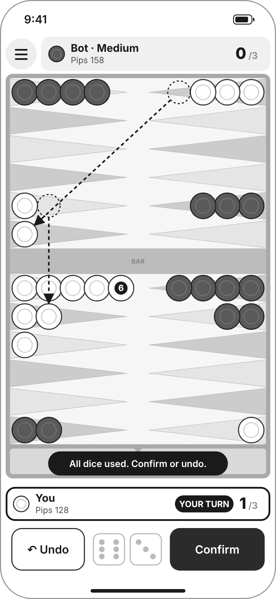

- All dice are used (both faded). **Confirm** becomes the main button. **Undo** still works.
- A short hint: "All dice used. Confirm or undo."
- With **auto-confirm** on (Settings), this state is skipped. The turn ends right after the last move.

### 6e. Opponent or bot turn

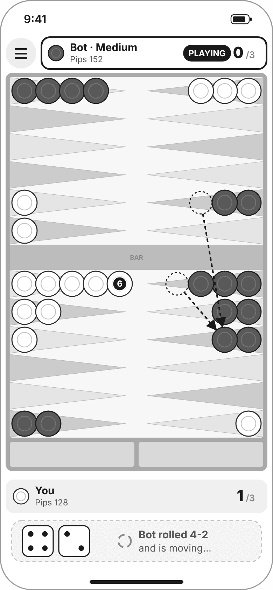

- The bot's strip is active ("PLAYING").
- The controls area turns into a locked box: the bot's dice and "Bot rolled 4-2 and is moving…".
- The bot's moves animate one by one. The bot's dice stay on screen before its first move, and each move lands before the next one starts (#172: about 0.9 s per move at Normal speed). Settings → Bot speed makes it slower or faster. Numbers: [Bot turn timing](../architecture/board-screen.md#bot-turn-timing-172).
- The bot's last move arrows stay until you roll.
- **Pass-and-play:** there is no locked state. After Confirm, the board flips (Flip mode) and the other player sees 6b with their name in the pill.

### 6f. No legal moves (auto-pass)

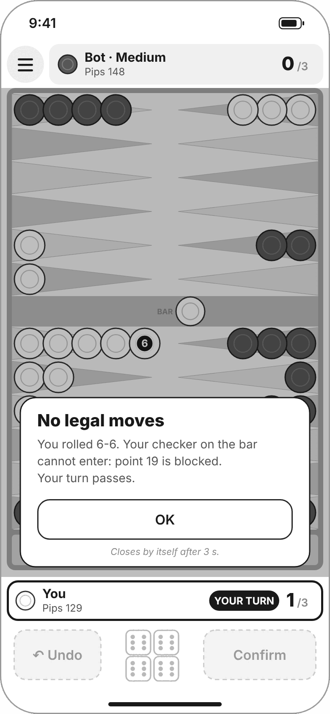

- The dice still show (faded) and are recorded (`tavli-match.md`, edge case 13).
- A card explains why in plain words: "You rolled 6-6. Your checker on the bar cannot enter: point 19 is blocked. Your turn passes."
- **OK** closes it. Your own pass waits for OK, so there is time to read why (#178). The image still shows the old "Closes by itself after 3 s." line.
- When the bot cannot move: "Bot cannot move. Your turn." It closes by itself after 3.5 s; OK closes it sooner.

### Board: other states

- *Loading (restore a saved game):* show the empty board and a small spinner. This should take well under 0.5 s.
- *Error (game cannot load):* dialog "This game could not be opened." → Home. The broken save is removed.
- *App goes to background:* the game saves after every confirmed turn (#36). Moves in progress are lost, which is fine.

## 7. In-game menu

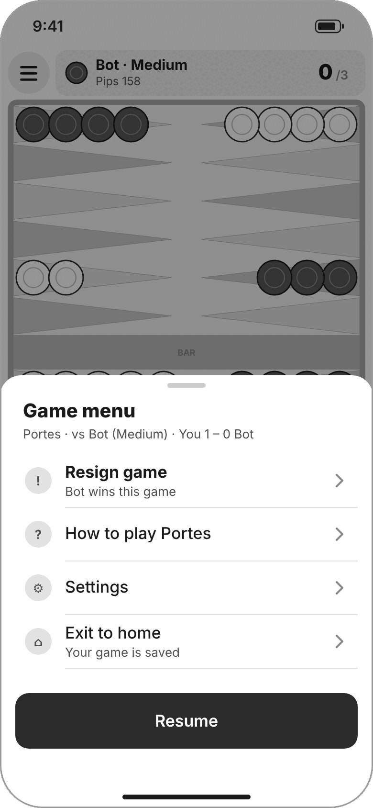
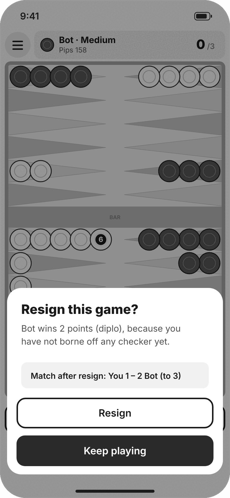

- **Route:** `app/game/[id]/menu.tsx` (form sheet). Opens from the menu button.
- **Purpose:** Pause, get help, change settings, resign or leave.
- **Elements (bottom sheet):**
  - Title "Game menu" and a line with game, opponent and match score.
  - **Resign game** (top, farthest from the thumb, so it is hard to hit by mistake).
  - **How to play Portes** → `/rules/portes`.
  - **Settings** → `app/settings.tsx` as a modal. Changes apply at once (sound, haptics, auto-confirm, board view).
  - **Exit to home** ("Your game is saved"). No confirm dialog, because nothing is lost.
  - **Resume** (main button, bottom, closest to the thumb). Swiping the sheet down also resumes.
- **Resign dialog:**
  - "Resign this game?", the points the opponent gets, and the match score after the resign.
  - **Resign** (outlined, heavy border) and **Keep playing** (main button, nearest the thumb).
  - In pass-and-play, the **current player** resigns. The text uses their name.
  - The number of points for a resign is an [open question](#open-questions-for-the-owner).
- **Goes to:** Board, Rules, Settings, Home, Game end (after resign).

### Future dialog: Plakoto mother pinned (MVP3)

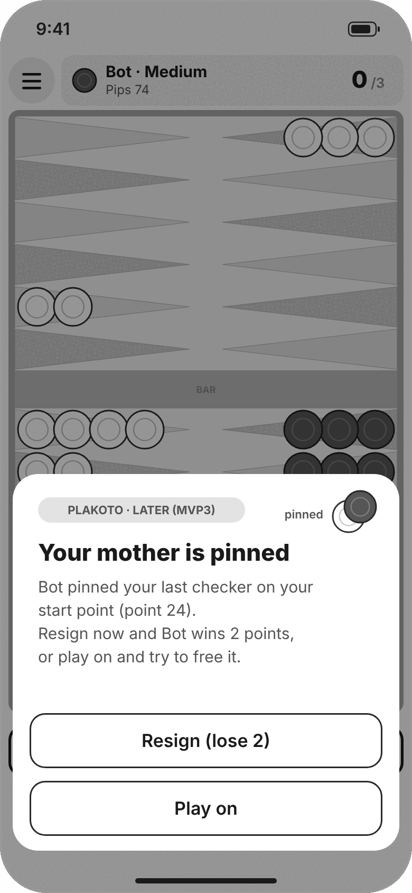

- Needed for `motherRule="offerConcede"` (`docs/rules/plakoto.md`).
- Shows to the player whose mother (last checker on their start point) gets pinned.
- Title "Your mother is pinned", a small pinned-checker picture, and a plain explanation.
- Two buttons with equal weight: **Resign (lose 2)** and **Play on**. The dialog cannot be dismissed without a choice.
- Vs bot: if the bot's mother is pinned, the bot decides. A toast says "Bot plays on" or "Bot resigns".
- Pass-and-play: in Flip mode the board turns to the pinned player first. Online (MVP2+): only the pinned player sees it.

## 8. Game end

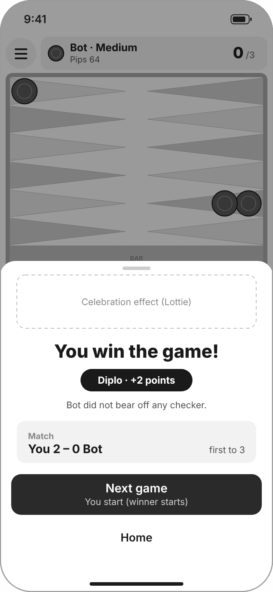

- **Route:** overlay in `app/game/[id]/index.tsx`.
- **Purpose:** Show who won this game, how, and where the match stands (#33).
- **Elements (sheet over the final board):**
  - Celebration effect area (Lottie). Only when a human wins.
  - Title: "You win the game!" / "Bot wins the game" / "Maria wins the game!".
  - Win type chip: **Mono · +1 point** or **Diplo · +2 points**. The English UI keeps the Greek names (`tavli-match.md`). The rules page explains them ("single" and "double").
  - Reason line, for example "Bot did not bear off any checker." or, after a resign, why it gives these points: "Diplo: Maria resigned before bearing off a checker." / "Mono: you resigned the game." (#181)
  - Acey-Deucey American (1 point per checker left, #245): the chip is "+5 points" (no Mono or Diplo), and the reason line counts the checkers: "Bot did not bear off 5 checkers: 1 point each." / "You resigned and did not bear off 5 checkers: 1 point each."
  - Match box: "You 2 – 0 Bot", "first to 3".
  - **Next game** (main button, "You start (winner starts)").
  - **Home** (text button). The match is saved, so Home shows "Continue game".
- **Goes to:** Board (next game, no opening roll), Home. If the target is reached, Match end replaces this overlay.

## 9. Match end

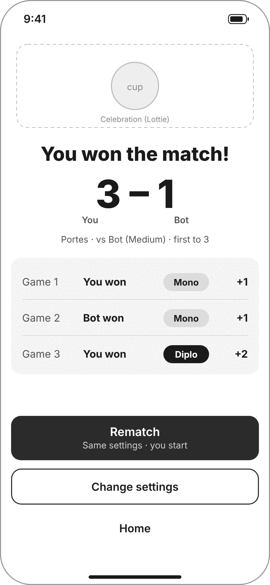

- **Route:** `app/game/[id]/match-end.tsx`
- **Purpose:** Close the match and offer the next step.
- **Elements:**
  - Celebration area (cup and confetti) when a human wins.
  - "You won the match!" / "Bot won the match" / "Maria won the match!".
  - After **Resign match**: "You resigned the match." / "Maria resigned the match." The score stays as it was (#181).
  - Big final score "3 – 1", with the names under it.
  - Line: game, opponent, target.
  - Game list: one row per game with winner, **Mono / Diplo** chip and points.
  - **Rematch** (main button, "Same settings · you start"). The last game's winner starts; no opening roll.
  - **Change settings** → New game, filled in.
  - **Home**.
- **States:** A lost match looks the same, but with no celebration. Rematch is still the main button.
- **Goes to:** Board (rematch), New game, Home. The finished match is removed from the save slot.

## 10. Settings

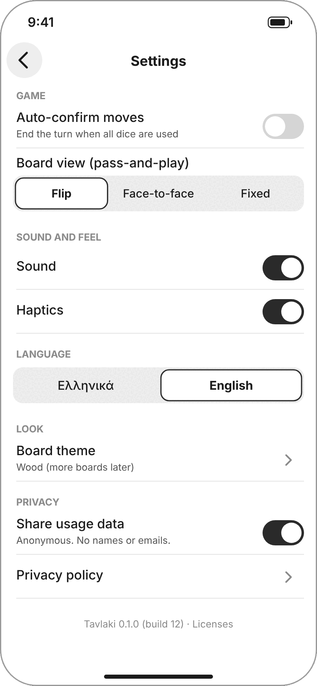
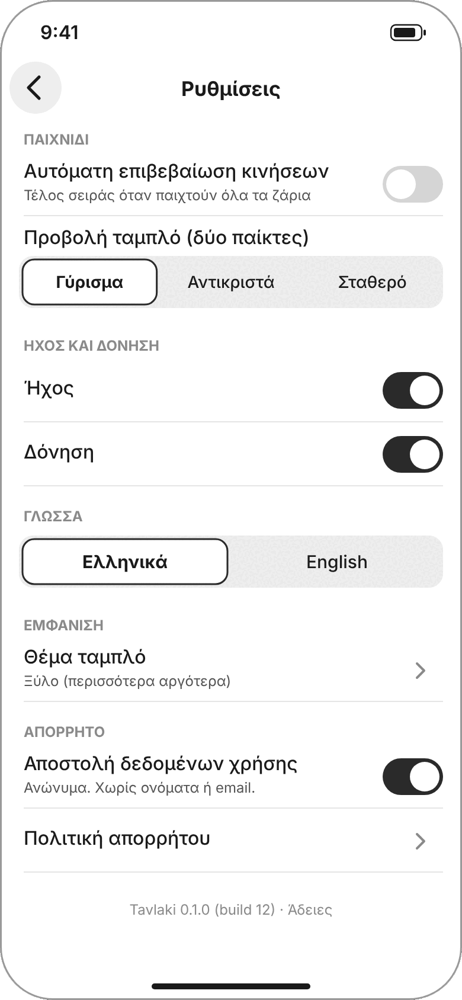

- **Route:** `app/settings.tsx`
- **Purpose:** Change app options (#37). All settings save on the phone at once (MMKV). There is no Save button.
- **Elements:**
  - **Game:** Auto-confirm moves (toggle, default off). Board view for pass-and-play (**Flip / Face-to-face / Fixed**, default Flip). Bot speed (**Slow / Normal / Fast**, default Normal; #172, not drawn).
  - **Sound and feel:** Sound (toggle). Haptics (toggle). Sound also follows the phone's silent switch.
  - **Language:** **Ελληνικά / English**. The app switches at once.
  - **Look:** Board theme (MVP1 has one wooden board; the row says "more boards later").
  - **Board** (#175, #184, not drawn): the board theme, **Board layout** (**Tall** / **Classic**, a small picture of the game screen each) and **Your home** (bottom right / bottom left).
  - **Help** (#128, not drawn): **Learn to play ›** opens a sheet with Portes, Plakoto, Fevga and Asodio (#159); a pick opens that game's lessons.
  - **Privacy:** Share anonymous usage data (toggle; calls `optIn()` / `optOut()` on the Analytics port, #61). Privacy policy link. Events: `docs/architecture/analytics-events.md`.
  - Footer: app version, build, licenses.
- **States:** No loading or error states; everything is local.
- **Goes to:** Back to where it came from (Home, or the game via the in-game menu).

---

## Board layout recommendation

> New layout proposals for portrait and landscape (#184, #185): [game-layout-proposals.md](game-layout-proposals.md). **Decision (#184):** both portrait layouts ship. Option B (rotated, as large as the screen) is the default; option A (the classic board, centred) is a setting.

A tavli board is wide (about 1.6 : 1). A portrait phone is tall (about 1 : 2.2). We need 24 points, the bar, two bear-off trays and a dice area.

### Option A: landscape board inside the portrait screen

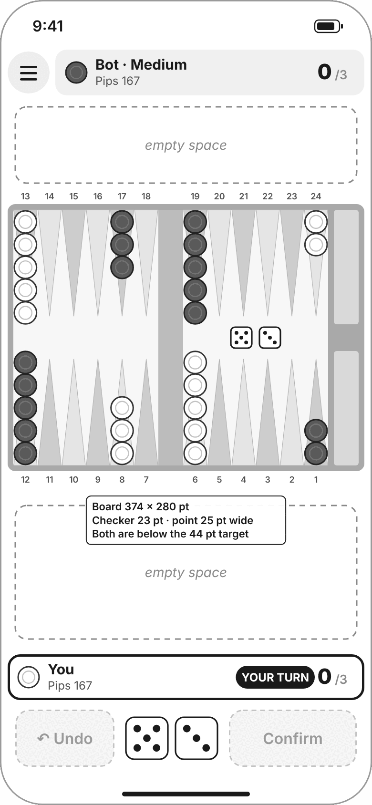

- The board looks like a real board seen from your chair. Top row = opponent side, bottom row = your side.
- On a 390 pt phone the board is only **374 × 280 pt**. A checker is **23 pt** and a point is **25 pt** wide. Both are below the 44 pt target.
- About 220 pt of height stays empty.
- Trays on the right edge, dice in the middle of the right half.

### Option B: board rotated 90° (fills the screen)

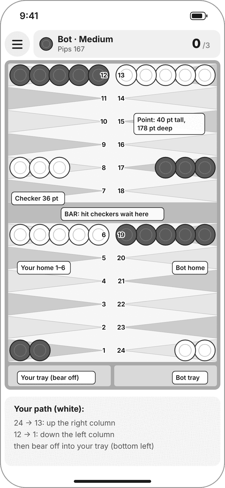

- The long side of the board runs top to bottom. The 12 points of each row form a **column**.
- Left column: points 12 → 7, BAR, 6 → 1 (your home at the bottom left).
- Right column: points 13 → 18, BAR, 19 → 24 (the opponent's home at the bottom right).
- Your checkers move from 24 (bottom right) **up** the right column, across the top, and **down** the left column into your home. Then they bear off into **your tray** right below your home.
- **Bar:** a horizontal band in the middle. Your hit checkers wait on the right half, next to where they enter (points 19–24). The opponent's wait on the left half.
- **Trays:** a strip under the board. Yours at bottom left, the opponent's at bottom right. Both are near the thumb.
- **Dice:** in the controls row under the board, between Undo and Confirm. The roll, the dice and the confirm are all in one thumb zone. (Since #184 the dice lie on the board, in the theme's dice area, and the controls row has two big buttons.)
- Sizes on a 390 × 844 phone: board **374 × 570 pt**, point **40 pt tall × 178 pt deep**, checker **36 pt**.
- On an iPhone SE (375 × 667) the point height drops to about **31 pt** (checker about 27 pt). The point is still 170 pt deep. To keep tapping easy, a tap snaps to the **nearest legal target** within 22 pt, and drags use extra hit slop.
- On large phones (430 × 932) points reach 44 pt.

### Face-to-face mode

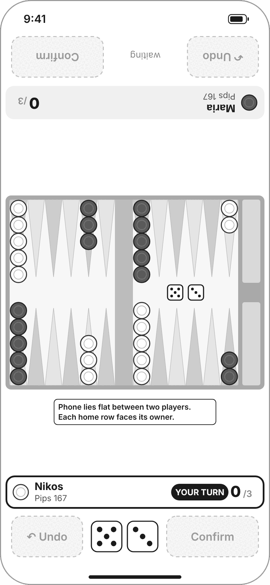

- The phone lies flat on the table between two players.
- Option B does not suit this. Both homes are at the same end, so the top player's home and tray would be far from them.
- Option A suits it well. Each player's home row faces them, like a real board. The top player's strip and buttons are turned 180°.
- So face-to-face uses the **Option A layout**. The theme holds both layouts as data (ADR-0005: "board layout is data").

### Pick: Option B (rotated) as the main layout

| | Option A: landscape in portrait | Option B: rotated 90° |
|---|---|---|
| Checker size (390 pt phone) | 23 pt | **36 pt** (2.4× the area) |
| Point touch size | 25 × 120 pt | **40 × 178 pt** |
| Screen used by the board | ~32% | **~65%** |
| Trays and dice near the thumb | No (right edge, mid-screen) | **Yes** (bottom) |
| Looks like a real board from your chair | **Yes** | No: you look at it from the short end |
| Face-to-face play | **Good** | Poor |

Why B:

- Checkers and points are big enough to drag with a thumb. This is the core of the game, and we play it hundreds of times per match.
- The board fills the screen. There is no dead space.
- Roll, move, bear off and confirm all happen in the lower half.
- Flip mode is simple. To turn the board to the other player we mirror it left to right. The current player's home is then always at the bottom left, and their path is always the same U shape. (Settings → Board → Your home → Bottom left mirrors the whole board, #175: the home is then always at the bottom right.)

Costs and follow-ups:

- Players who know landscape apps need a moment to adapt. The point numbers (optional, small, in the theme) and the first-game hint help.
- The v1.0 Blender skin must be rendered for the **portrait** orientation, with light from the top of the screen. The art pipeline says to fix orientation before any render, so this pick unblocks #13.
- `theme.json` gets `"orientation": "portrait"` as the main layout and an optional `"landscape"` layout for face-to-face.

## Greek length check

Draft translations, only to size the layout. Final strings come from #37.

| English | Greek (draft) | Characters | Growth |
|---|---|---|---|
| Your turn | Σειρά σου | 9 → 9 | 0% |
| Rematch | Ρεβάνς | 7 → 6 | −14% |
| Coming soon | Έρχεται σύντομα | 11 → 15 | +36% |
| Continue game | Συνέχεια παιχνιδιού | 13 → 19 | +46% |
| Resign | Παραίτηση | 6 → 9 | +50% |
| Confirm | Επιβεβαίωση | 7 → 11 | +57% |
| Auto-confirm moves | Αυτόματη επιβεβαίωση κινήσεων | 18 → 29 | +61% |
| Pass-and-play | Δύο παίκτες, ένα κινητό | 13 → 23 | +77% |
| Undo | Αναίρεση | 4 → 8 | +100% |
| Play vs bot | Παίξε με τον υπολογιστή | 11 → 23 | +109% |

Rule of thumb: plan **+100%** for labels under 12 characters and **+30%** for sentences. The Greek Home and Settings wireframes above use these strings and still fit. The tightest spot is the Undo button (104 pt wide). "↶ Αναίρεση" at 16 pt semibold measures about 92 pt, so only ~6 pt is left on each side. Do not make it narrower. "Επιβεβαίωση" (about 102 pt) fits the 134 pt Confirm button.

## Open questions for the owner

1. **Board layout:** Is the rotated board (Option B) OK as the main layout? For face-to-face, should we build the classic layout (Option A) in MVP1, or move face-to-face to a later release to save time?
2. **Resign points in Portes:** How many points does the opponent get? Proposal: what the position is worth now, so diplo (2) if the resigning player has borne off no checker, else mono (1). Do we also want "Resign match"?
3. **Opening roll:** Does one tap roll both opening dice (fast), or does each player tap for their own die (more like the kafeneio)? Proposal: one tap vs bot, one tap per player in pass-and-play.
4. **Auto-confirm default:** Off (safer; you always see Confirm and can undo) or on (faster)? Proposal: off.
5. **Pip counts:** Always shown (proposal), or a setting, since some kafeneio players see pip counts as "help"? **Answer:** first a setting, shown by default (#32); later the owner removed the pip count (#238).
