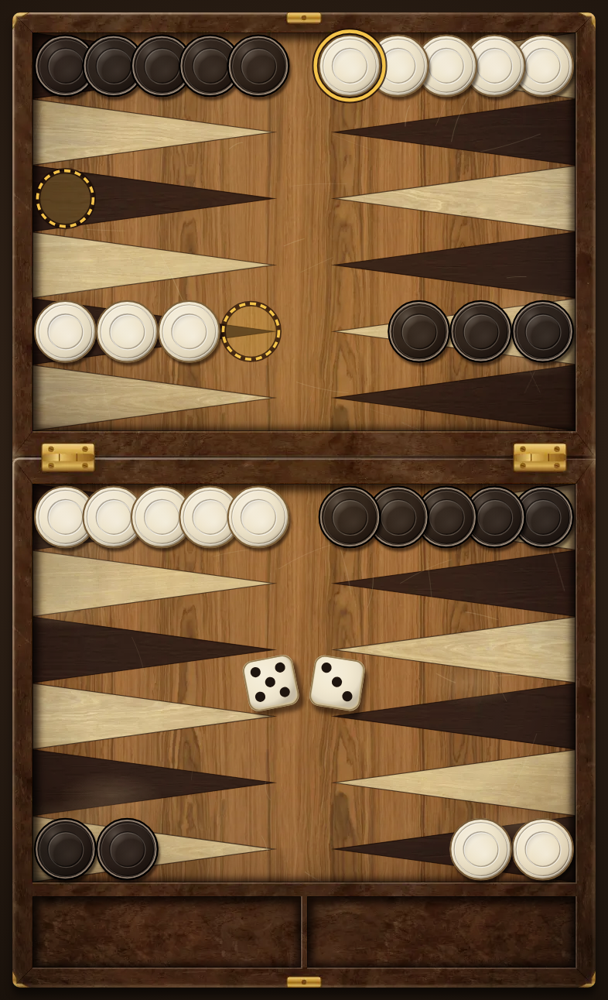
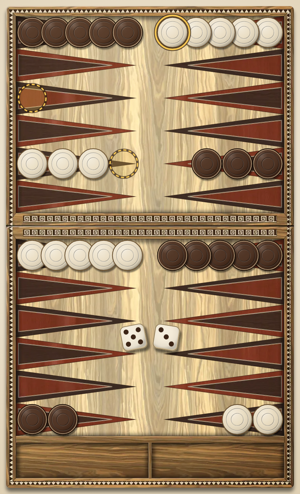
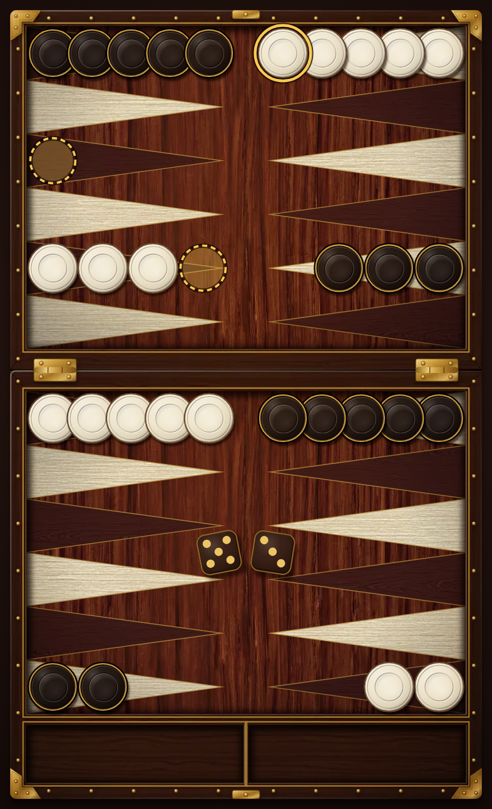

# @tavli/themes

Board themes ("skins") for Tavlaki. A theme is **data**: a `theme.json` manifest plus WebP images. The board renderer reads only the manifest. It never hard-codes art, colors or positions (ADR-0005).

This package is pure TypeScript plus assets. It has no React, no network and no vendor code.

## Bundled themes

| Id                          | Name                                | Look                                                                                                      | Size    |
| --------------------------- | ----------------------------------- | --------------------------------------------------------------------------------------------------------- | ------- |
| `walnut-kafeneio` (default) | Walnut Kafeneio / Καρυδιά Καφενείου | Worn dark walnut, ebony and bone points, brass hinges, a warm lamp (Concept B)                            | ~1.1 MB |
| `olive-inlay`               | Olive Inlay / Ελιά με ένθετα        | Light olive wood, inlaid wenge and mahogany points, dog-tooth banding, a Greek key on the bar (Concept A) | ~1.1 MB |
| `kafeneio-night`            | Kafeneio Night / Νυχτερινό Καφενείο | Deep mahogany field, black walnut frame with brass corner plates and nails, rosewood and pale ash points  | ~0.9 MB |

All themes share **one geometry**: the same points, bar, trays, dice area and checker size (`themes.test.ts` checks it). Olive Inlay and Kafeneio Night import the geometry from `tools/walnut-kafeneio/design.mjs`. Only the art differs, so the hit test, the tutorial and the rules pictures work the same on every board.

The player picks a board in Settings → Board (`boardTheme` setting). See `docs/architecture/board-screen.md`.

| Walnut Kafeneio                                                                                    | Olive Inlay                                                                                | Kafeneio Night                                                                                   |
| -------------------------------------------------------------------------------------------------- | ------------------------------------------------------------------------------------------ | ------------------------------------------------------------------------------------------------ |
|  |  |  |

## Folder layout

```
packages/themes/
  src/                     TypeScript: types, validation, registry, layout math
  walnut-kafeneio/         One folder per theme. Everything here ships in the app.
    theme.json             The manifest
    board-portrait.webp    Image layers, @1x, @2x and @3x
    ...
  olive-inlay/             The second theme, same layout of files
  kafeneio-night/          The third theme, same layout of files
  tools/
    build-assets.mjs       Builds the images and the layout block of theme.json
    preview.mjs            Renders preview/*.png from the manifest
    lib/                   Geometry, SVG, Chromium and canvas helpers
    walnut-kafeneio/       Art source of one theme: design.mjs, textures/, prepare_textures.py
    olive-inlay/           Art source of Olive Inlay: design.mjs, textures/
    kafeneio-night/        Art source of Kafeneio Night: design.mjs, textures/, prepare_textures.py
  preview/                 Preview renders (not shipped)
  LICENSES.md              Source and license of every asset
```

## Use a theme

```ts
import {
  getLayout,
  getTheme,
  imageFileName,
  pickScale,
  stackCenters,
  getPoint,
} from '@tavli/themes';

const theme = getTheme('walnut-kafeneio'); // validated, palette tokens resolved
const layout = getLayout(theme); // the default: 'portrait-rotated'
const stack = stackCenters(layout, getPoint(layout, 13), 5); // normalized checker centers
const board = theme.images['boardPortrait']!;
const file = imageFileName(board, pickScale(board, 3)); // 'board-portrait@3x.webp'
```

Multiply normalized values by the drawn board size: `x * boardWidth`, `y * boardHeight`. Lengths in "width units" (radius, spacing) are multiplied by `boardWidth`.

## The manifest

`src/types.ts` has the full type, with a comment on every field. `src/validate.ts` checks it at load time.

| Key                     | What                                                                                     |
| ----------------------- | ---------------------------------------------------------------------------------------- |
| `id`, `version`, `name` | Folder name, semver, name in `en` and `el`                                               |
| `description`, `kind`   | Short text in both languages; `image` (image layers + vector points) or `vector`         |
| `license`               | Short license notes and the file with the full list (`LICENSES.md`)                      |
| `palette`               | Color tokens (from `docs/design/style/palette.md`). Other fields use them as `{token}`.  |
| `images`                | Every image: file name, scales, @1x size                                                 |
| `layouts`               | Board geometry for `portrait-rotated` (default) and `landscape`                          |
| `points`                | Dark and light point woods: fallback color and texture tile                              |
| `checkers`              | Light and dark checker styles (fill, rim, highlight, ring, dish, grooves), shadow, badge |
| `highlights`            | Selected checker ring and legal target ring                                              |
| `dice`                  | Face, pips (red ace pip), corner radius, shading, shadow                                 |
| `sounds`, `haptics`     | Per game event (`FeedbackEvent`): sound file(s) in `sounds/` and a haptic pattern        |
| `accessibility`         | Checker contrast (the tests compute it again) and the color-blind checks done            |

### Units

- **Normalized** rects and points: 0..1 of the board width (`x`, `w`) and height (`y`, `h`).
- **Width units** for layout lengths (checker radius, stack spacing, die size, tile size): fractions of the board width.
- **Radius units** inside a checker style: fractions of the checker radius.
- **Die units** inside the dice style: fractions of the die size.

### Layouts

Point numbers are from the view of the player at the **bottom** of the screen. That player moves 24 → 1 and bears off into `trays.player`. The renderer maps engine points to these slots (and mirrors them for the other player's view).

| Layout                       | Board        | Your home    | Trays       | Use                                    |
| ---------------------------- | ------------ | ------------ | ----------- | -------------------------------------- |
| `portrait-rotated` (default) | 377 × 630 pt | bottom-left  | bottom edge | Phone in portrait (wireframe option B) |
| `landscape`                  | 630 × 377 pt | bottom-right | right edge  | Tablets, face-to-face play             |

Portrait order: the left column holds 12 → 7, the bar, then 6 → 1. The right column holds 13 → 18, the bar, then 19 → 24.

Each layout has:

- `points`: 24 slots. Each has a `rect` (hit area and stack area), a `base` side (where the triangle base is; stacks grow away from it) and a `tone`.
- `bar.player` / `bar.opponent`: where hit checkers wait. `trays.player` / `trays.opponent`: bear-off trays.
- `diceArea`, `fields` (the two recesses), `pointShape` (triangle depth and seam), `checker` (radius, spacing, `maxVisible: 5`), `dice` (size, tilt), `shadow` and an optional `overlay` (the lamp).

A stack shows at most `maxVisible` checkers. Above that, the last checker gets a count badge (`stackCenters` returns `badge`). If a stack does not fit, the spacing shrinks.

**Mirror (home board on the bottom left, #175).** `mirrorLayout(layout)` mirrors every slot left to right: points (rect and base), bar halves, trays, fields and the dice area. Point numbers and tones stay. The app uses it for Settings → Your home → Bottom left. The images, the shadow and the lamp are not mirrored, so the light stays on the same side. So the art must fit both ways: the frame, fields, bar, bar halves, trays and points must be left–right symmetric. `isMirrorSymmetric(layout)` checks it, and `themes.test.ts` runs it on every portrait layout.

## Draw order for the Skia renderer

1. `layout.shadow` under the board (a blurred rounded rect).
2. Layers with `z: "underPoints"` (`board-*`): frame, bar, hinges, trays, wood field.
3. The 24 points: a triangle path (`pointTriangle`), filled with the point `fill`, then with an image shader of the `texture` tile. Scale the tile to `tileSize × boardWidth`, rotate it by `tileRotation`. Then stroke the `seam`.
4. Layers with `z: "overPoints"` (`shade-*`): wear, grime and the frame's inner shadow.
5. Checkers (`stackCenters`), with the count badge. Borne-off checkers in the trays (`trayRects`).
6. Highlights, then dice (`diceCenters`).
7. `layout.overlay`: the warm lamp, with a soft-light blend, over everything.

Light comes from the top-left of the screen in both layouts. The landscape images are drawn again for that light; they are not a rotated copy.

### Why the points are vectors

The points are paths in the manifest, filled with a small wood tile. They are not baked into the board image:

- **Sharp at every size.** Skia draws path edges with anti-aliasing at the device resolution. A baked image gets soft edges when it is scaled to a phone that is not exactly 377 pt wide.
- **One source of truth.** The triangle drawn on screen is the same data the hit test and the highlights use. Art and layout cannot drift apart.
- **Cheap.** 24 paths with one image shader are nothing for Skia. The tiles weigh 2–13 KB each, and both layouts share them.
- **Easy to change.** Another wood or color is a manifest change, not a new render.

The "shade" layer then puts wear and the frame shadow over the points, so they still look inlaid.

## Assets

- WebP, file names in the React Native style: `board.webp` (@1x), `board@2x.webp`, `board@3x.webp`. Metro picks the right scale. `scales` lists the files on disk.
- @1x pixels = points at the layout's `referenceSize`. For a bigger board, pass `pixelRatio × drawnWidth / referenceWidth` to `pickScale`.
- Budget: **under 2 MB per theme** (a test checks it). Each bundled theme is about 0.9–1.1 MB with its sounds.
- Every bundled theme ships in the app (Metro bundles each `require` in `themeImages.ts`), even when the player never picks it. Keep themes small. A much bigger theme (a Blender skin) should be a download, loaded on demand, not a bundled theme.

## Scripts

```sh
pnpm --filter @tavli/themes build:assets   # images + layout block of theme.json (add `-- <id>` for one theme)
pnpm --filter @tavli/themes preview        # preview/*.png from theme.json
pnpm --filter @tavli/themes preview -- --debug   # *-debug.png with every layout rect outlined (not committed)
pnpm --filter @tavli/themes test
```

The app's own Skia renderer can also draw a theme headless: `pnpm --filter @tavli/mobile screenshots` writes `apps/mobile/docs/screenshots/board-start*.png` (one per board).

Both tools need Node 22.18 or newer and Playwright with Chromium on the machine (`require('playwright')` must work). Chromium draws the SVG art and encodes the WebP, so no native image library is needed. The build gives the same bytes on every run with the same Chromium.

`build:assets` writes only the `images` and `layouts` keys of `theme.json`. Edit every other key by hand.

To change a wood grade, run `tools/walnut-kafeneio/prepare_textures.py` or `tools/kafeneio-night/prepare_textures.py` (Python, numpy, Pillow). The header says how.

### Sounds

`sounds` maps each game event (`checkerPlace`, `checkerHit`, `bearOff`, `diceRoll`, `diceLand`, `invalidMove`, `turnStart`, `gameWin`, `matchWin`, …) to one file, a list of takes, or `null` (silent). Files live in `<id>/sounds/`, kebab-case, `.m4a` (mono AAC) or `.mp3`. The app plays the takes in turn. The tests check that every file exists, is audio, is under 48 KB, and that all sounds of a theme stay under 500 KB.

Olive Inlay and Kafeneio Night use the same sound files as Walnut Kafeneio (a copy in `olive-inlay/sounds/` and `kafeneio-night/sounds/`, about 54 KB each): all boards are wood on wood.

To change a Walnut Kafeneio sound, edit and run `tools/walnut-kafeneio/build_sounds.py` (Python, numpy, ffmpeg). Its header says how. The app needs a Metro `require` for each sound file: add it to `apps/mobile/src/features/feedback/themeSounds.ts` (a test checks this).

### Olive Inlay notes

- The **inlaid core** of each point (a smaller triangle of the other wood with maple stringing) is part of the `shade-*` layer. It is drawn from the same geometry as the vector points, so the two always line up.
- The dog-tooth banding and the meander are drawn as SVG paths and patterns in `tools/olive-inlay/design.mjs`. They are flat inlay, so the landscape images turn them with the board; the bevels and shadows are drawn again for the light at the top-left.
- Light is soft daylight from the top-left (`overlay`), not a lamp.
- The cream checker is close to the light field in fill (1.38:1). Its dark rim carries the contrast (3.92:1). The tests allow this "fill or outline" rule for the field, as for the points, and ask for a rim of at least 0.05 radius. The dark checker fill stands out from the field on its own (6.64:1).

### Kafeneio Night notes

- The dark board of the three (issue #144). The field is mahogany at `#4C2015`; the frame is black walnut. Brass corner plates, nails, hinges and a thin brass stringing round each recess are drawn in `tools/kafeneio-night/design.mjs` (board layer). The shade layer darkens the field edges and draws the frame's inner shadow.
- The points have a **brass seam** (`board.point.seam`, set in `layoutBlock`), so the dark rosewood points stay apart from the mahogany field (5.05:1 seam vs rosewood, 4.30:1 seam vs field; rosewood vs field is only 1.18:1 by fill).
- The ebony checker is close to the field in fill (1.36:1). Its **brass ring** (0.075 radius, wider than the grey ring of Walnut Kafeneio) carries the contrast: 5.36:1 on the field, 6.30:1 on rosewood. The ivory checker stands out by its fill (10.9:1 on the field). Ivory vs ebony is 14.8:1.
- Highlights: the gold ring is 8.74:1 on the field and 10.3:1 on rosewood; on the pale ash the dark halo does the work (12.9:1). The landing hint has a little more fill (`fillOpacity` 0.3). `themes.test.ts` checks that the ring or the halo stands out ≥ 3:1 from the field and from both point woods, on every theme.
- Dice are dark (`#2A1A14`) with gold pips (10:1) and a coral ace pip (5.6:1), with a brass edge that sets them off the dark field.
- The `ui.*` tokens are dark, like Walnut Kafeneio (text 13.8:1, dim text 7.7:1).

## Add a theme

1. Make a folder `tools/<id>/` with a `design.mjs` that exports the geometry and the layer SVGs (copy `kafeneio-night` or `olive-inlay`: they reuse the shared geometry, and the SVG helpers in `tools/lib/svg.mjs`). Put its CC0 textures in `tools/<id>/textures/`.
2. Add the id to `THEMES` in `tools/build-assets.mjs` and run `build:assets`. Or, for a Blender skin, export the images and the layout block from Blender (`docs/design/art-pipeline.md` §4.2).
3. Write the rest of `<id>/theme.json` by hand: name, palette, points, checkers, highlights, dice, sounds, haptics.
4. Add it to `BUNDLED` in `src/registry.ts` and to `exports` in `package.json`. In the app, add its images to `apps/mobile/src/features/board/themeImages.ts` and its sounds to `apps/mobile/src/features/feedback/themeSounds.ts` (tests check both). Settings → Board lists it by itself.
5. Run `pnpm test`. The tests check every bundled theme: the manifest, 24 points with no overlaps, every rect inside 0..1, every file on disk at the right size, every sound file, no unused files, the 2 MB budget, the 500 KB sound budget, the same geometry as the default theme, and contrast (checkers ≥ 7:1; checker vs point and checker vs field ≥ 3:1 by fill or outline; one checker fill ≥ 3:1 from the field; highlight ring or halo ≥ 3:1 from the field and both points; dice pips ≥ 3:1; badge text and UI text ≥ 4.5:1).
6. Run `preview` and look at the PNG. Then list every new file in `LICENSES.md`.
